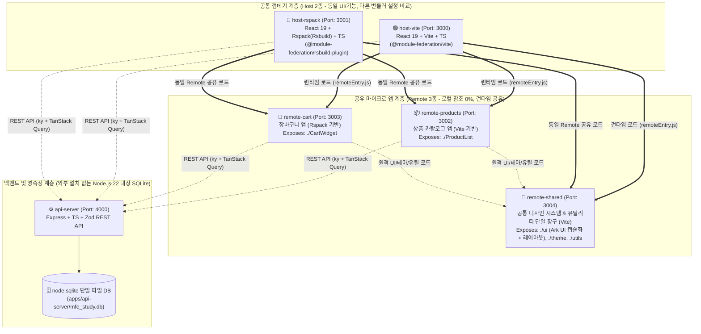

# 🚀 MFE (Micro Frontend) 폴리레포 호환 실전 학습 테스트베드 (`mfe-study`)

> **프로젝트 목적**: `pnpm workspaces + Turborepo` 인프라 위에서 로컬 코드 참조(`workspace:*`) 없이 오직 **Module Federation 2.0 런타임 네트워크 로딩**으로만 결합되는 **Vite 호스트**, **Rspack 호스트**, **공통 디자인·유틸 리모트(`remote-shared`)**, **도메인 리모트 2종(`remote-products`, `remote-cart`)**, 그리고 **Node.js 22 내장 SQLite 백엔드(`api-server`)**를 **5단계 TDD 워크플로우와 AI 하네스** 기반으로 구축·검증하는 실전 프로젝트입니다.

---

## 1. 시스템 아키텍처 및 포트 할당표



| 공식 스코프 ID | 워크스페이스 패키지명 | 대상 폴더 경로 | 포트 | 번들러 / 엔진 | 주요 역할 |
| :---: | :--- | :--- | :---: | :---: | :--- |
| **`root`** | `mfe-study-root` | 루트 / `docs` / `.agents` / `scripts` | - | **Turborepo / Biome** | 전체 워크스페이스 설정, 마스터 [`todo.md`](./todo.md), 공통 설계 정본(SSOT), AI 하네스 |
| **`host-vite`** | `@mfe-study/host-vite` | `apps/host-vite` | `3000` | **Vite** | Vite 기반 메인 대시보드 + 실시간 MFE 학습 모니터(`MfeInspector`) |
| **`host-rspack`** | `@mfe-study/host-rspack` | `apps/host-rspack` | `3001` | **Rspack (Rsbuild)** | Rspack 기반 메인 대시보드 (`host-vite`와 동일 기능을 Rspack으로 구동해 비교) |
| **`products`** | `@mfe-study/remote-products` | `apps/remote-products` | `3002` | **Vite** | 상품 목록 조회, 장바구니 담기(`Mode A: CustomEvent` vs `Mode B: sharedQueryClient` 비교), 단독 실행 |
| **`cart`** | `@mfe-study/remote-cart` | `apps/remote-cart` | `3003` | **Rspack (Rsbuild)** | 장바구니 조회/삭제, 동기화 모드(`Mode A` vs `Mode B`) 비교, CSS 격리 토글, 단독 실행 |
| **`shared`** | `@mfe-study/remote-shared` | `apps/remote-shared` | `3004` | **Vite** | **`Ark UI` 단일 창구 캡슐화**: 공통 컴포넌트, 레이아웃(`Splitter`, `Tabs`, `Grid` 등), 테마, 유틸리티 노출 |
| **`api`** | `@mfe-study/api-server` | `apps/api-server` | `4000` | **Node.js 22 (`node:sqlite`)** | 상품/장바구니/인증 REST API 및 상시 동기화되는 3종 SQL 관리 |

---

## 2. 빠른 시작 가이드 (macOS & Windows 공통)

### 사전 요구 사항
- **Node.js**: `v22.5.0` 이상 필수 (내장 `node:sqlite` 모듈 사용)
- **pnpm**: `v9.15+` (`corepack enable` 및 `corepack prepare pnpm@9.15.5 --activate`)

```bash
# 1. 의존성 설치 및 Git Hook(Lefthook) 자동 등록
pnpm install

# 2. 전체 단위·통합 TDD 테스트 실행
pnpm test

# 3. 코드 포맷팅 및 린트 검사 (Biome)
pnpm check

# 4. 전체 마이크로 앱(Host 2 + Remote 3 + Backend 1) 동시 실행 (Phase 1 구축 후)
pnpm dev
```

---

## 3. 영구 학습 가이드(`docs/study/`) 및 표준 템플릿(`docs/templates/`) 지도

### 📚 핵심 학습 문서 시리즈 (`docs/study/`)
1. **[Study 01. MFE 개념 및 핵심 원리 가이드](./docs/study/01-mfe-concepts-and-guide.md)**: MFE 기본 원칙, 4대 통합 패턴, Q1~Q8(`Mode A` vs `Mode B` 상태 동기화 비교), 6대 실습 프로세스, 3대 디버깅 툴
2. **[Study 02. 물리적 멀티레포 전환과 아키텍처 의사결정 노트](./docs/study/02-polyrepo-and-architecture-decisions.md)**: 멀티레포 5대 엔지니어링 과제, 경량 FSD(`exposed/` + `features/{ui,api,model}`), 하이브리드 테스트 배치, SSOT 정본 참조 원칙, 선정 라이브러리 역할
3. **[Study 03. TDD 워크플로우 및 AI 하네스 가이드](./docs/study/03-ai-harness-and-tdd-workflow-guide.md)**: 5단계 TDD 사이클, 단계별 모델(`Argon High` ↔ `Argon Medium`) 전환 전략, 하네스 3계층 및 5대 훅 동작 원리
4. **[Study 04. MFE 미경험자는 미리 알 수 없는 14대 실전 이슈와 해결 아키텍처](./docs/study/04-mfe-real-world-pitfalls-and-solutions.md)**: 싱글톤 `eager` 에러, 에셋 404, 다중 포트 `CORS`, 전역 CSS Reset 참사, `z-index` 전쟁, 좀비 이벤트 리스너, 런타임 MF 스모크 테스트 등
5. **[Study 05. 풀스택 서비스 구현 16대 실전 이슈와 해결 아키텍처](./docs/study/05-fullstack-service-real-world-issues.md)**: `Race Condition`(`ky` + `AbortSignal`), `Waterfall` 방지, `node:sqlite` 외래키 `PRAGMA`, 원자적 `UPSERT`, `Zod` + `React Hook Form` 경계 검증, `CLS` 방지 등

### 📝 표준 작업 템플릿 (`docs/templates/`)
- **[todo.template.md](./docs/templates/todo.template.md)**: 마이크로 앱별 `docs/todo.md` 생성 템플릿
- **[01-plan-and-design.template.md](./docs/templates/01-plan-and-design.template.md)**: [1단계] 기획 및 상세 설계서 템플릿 (SSOT 항목 참조 포함)
- **[02-tdd-spec.template.md](./docs/templates/02-tdd-spec.template.md)**: [2단계] TDD 테스트 명세서 템플릿
- **[03-code-review.template.md](./docs/templates/03-code-review.template.md)**: [5단계-A] PR 생성 전 보안·MFE 14대·서비스 16대 이슈 정밀 코드 리뷰 템플릿
- **[pull-request.template.md](./docs/templates/pull-request.template.md)**: [5단계-B] PR 초안 및 순수 텍스트 커밋 메시지 보고 템플릿
