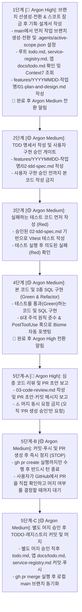

# 📙 Study 03. 프로젝트 전반적인 TDD 워크플로우 및 AI 하네스(Hook & Rule) 학습 가이드

> **문서 목적**: 우리 프로젝트가 어떤 순서와 규칙으로 개발되는지(**5단계 TDD 워크플로우**), 그리고 AI 에이전트가 실수하거나 규칙을 건너뛰지 않도록 어떻게 **하네스(`GEMINI.md`, `.agents/hooks.json`, `lefthook.yml`)**로 제어하는지 그 전체 동작 원리를 정리한 학습 노트입니다.

---

## 1. 한눈에 보는 전체 5단계 TDD 개발 워크플로우

모든 기능 개발과 데이터베이스 작업은 예외 없이 아래 **1단계 ~ 5단계** 사이클로 진행됩니다.

### 단계별 핵심 체크포인트
1. **왜 1단계 문서 작성 전에 반드시 작업 브랜치를 먼저 만들고 스코프를 잠그나요 (`Branch & Scope Lock`)?**
   - 설계서(`01`)나 TDD 명세서(`02`)를 `main` 브랜치 위에서 작성하면 `main` 워킹 트리가 오염되거나 브랜치 분기 시점이 꼬이게 됩니다.
   - 따라서 **새 작업을 시작할 때는 어떤 파일도 수정하기 전에 반드시 `main`에서 작업 브랜치를 먼저 생성·전환하고 `.agents/active-scope.json`을 설정**합니다. 만약 실수로 `main` 브랜치 위에서 파일 생성·수정을 시도하면 `verify-scope.mjs` 훅이 즉시 차단합니다.
2. **왜 5단계를 `PR 생성 후 정지(5-B)`와 `별도 승인 후 머지(5-C)`로 엄격히 분리하나요?**
   - 에이전트가 PR 생성과 머지를 한 번에 묶어서 실행해 버리면, 승인자(사용자)가 GitHub PR 화면에서 전체 변경분(Diff)과 리뷰 문서를 직접 검토하고 반려·보완을 지시할 기회가 사라집니다.
   - 따라서 **5단계-B에서는 반드시 `gh pr create`(PR 생성)까지만 수행하고 즉시 턴을 종료**하며, `verify-todo-before-merge.mjs` 훅이 `gh pr create`와 `gh pr merge`를 한 명령줄에 묶어 실행하는 시도를 기계적으로 차단합니다.
   - 이후 사용자가 PR을 검토하고 **별도로 머지를 승인했을 때(`5단계-C`)에만** 루트 `todo.md`, 앱 `docs/todo.md`, `docs/service-registry.md`를 업데이트해 먼저 커밋·푸시한 뒤 실제 머지를 수행합니다.
4. **왜 단계별로 `Argon High`와 `Argon Medium` 모델을 번갈아 사용하며, 어떻게 훅으로 알림을 받나요?**
   - 실제 작업에서 **토큰 소모량의 약 70% 이상은 긴 테스트 코드, 본 코드, JSDoc 주석을 타이핑하는 2~4단계**에서 발생합니다. 이 구간은 이미 1단계에서 완성된 설계서를 보고 구현하는 정형화된 작업이므로 `Argon Medium`으로 진행하면 품질 저하 없이 토큰을 절반 이하로 절약할 수 있습니다.
   - 반면 **깊은 추론과 비판적 검증이 필요한 1단계(기획·설계)와 5단계 전반부(`03-code-review.md` 보안·실전 이슈 정밀 감사)**에만 `Argon High`를 집중 투입합니다.
   - 사용자가 모델 변경 타이밍을 놓치지 않도록 `.agents/active-scope.json`에 현재 단계(`currentStep`)를 기록하고, `PreInvocation` 및 `Stop` 훅이 단계 전환 시점(1단계 완료 직후 → `Medium` 권장 / 4단계 완료 직후 → `High` 권장)마다 화면에 **모델 전환 알림 배너**를 자동으로 띄워줍니다.

---

## 2. 규칙을 기계적으로 강제하는 AI 하네스(Harness) 3계층 구조

사람이나 AI가 기억력에만 의존해 컨벤션을 지키려 하면 대화가 길어질수록 규칙을 잊어버리기 쉽습니다. 이를 방지하기 위해 **3계층 방어선**을 구축합니다.

| 계층 | 구성 파일 | 동작 주체 | 핵심 역할 |
| :---: | :--- | :---: | :--- |
| **계층 1** *(헌법 및 지침)* | `GEMINI.md` `docs/templates/*.template.md` | AI 에이전트 | 세션 시작 시 항상 로드되는 최상위 규칙 (5단계 TDD 절차, `root` 공통 설계 항목 참조 원칙, 한국어 가독성 원칙, 6대 주석 원칙, 5종 템플릿 참조 지시) |
| **계층 2** *(에이전트 라이프사이클 훅)* | `.agents/hooks.json` `.agents/active-scope.json` `scripts/*.mjs` | Antigravity CLI 훅 엔진 | 에이전트가 도구를 쓰거나 턴을 시작·종료할 때 Node.js 스크립트가 개입해 **TODO 주입, 타 서비스 수정 차단, 자동 포맷팅, 머지 전 TODO 갱신 검증** 수행 |
| **계층 3** *(Git 로컬 저장소 훅)* | `lefthook.yml` | Git (`pre-commit`, `pre-push`) | 커밋·푸시 직전에 `Biome` 포맷팅/린트, 3종 SQL 해시 동기화, 전체 `Vitest` 통과 여부를 최종 검증하고 `main` 직접 푸시 차단 |

---

## 3. 에이전트 라이프사이클 5대 훅(`.agents/hooks.json`) 상세 동작 원리

### 3.1 `SessionStart` & `PreInvocation` — 컨텍스트 자동 주입 (`inject-context.mjs`)
* **언제 실행되나요?**: AI CLI를 처음 켰을 때(`SessionStart`) 또는 매 대화 턴마다 모델이 응답을 생성하기 직전(`PreInvocation`)에 실행됩니다.
* **무엇을 하나요?**:
  - 루트 `todo.md`와 현재 활성화된 앱의 `apps/<서비스>/docs/todo.md`, 그리고 `.agents/active-scope.json` 상태를 읽어들여 에이전트에게 자동으로 주입(`injectSteps`)합니다.
  - 덕분에 에이전트가 수동으로 TODO 파일을 읽는 것을 깜빡하더라도 항상 최신 할 일과 핵심 규칙을 숙지한 상태로 동작합니다.

### 3.2 `PreToolUse` — 작업 스코프 강제 게이트 & 머지 전 TODO 검증 (`verify-scope.mjs` / `verify-todo-before-merge.mjs`)
* **언제 실행되나요?**: 에이전트가 파일 생성·수정 도구(`write_file`, `edit_file`)나 터미널 명령 도구(`run_command`)를 실행하기 **바로 직전**에 실행됩니다.
* **핵심 동작 1 — `main` 직접 수정 차단 및 물리적 멀티레포 스코프 격리 (`verify-scope.mjs`)**:
  - 현재 체크아웃된 Git 브랜치가 `main` 또는 `master`일 경우, 문서를 포함한 모든 파일 생성·수정을 즉시 **`"decision": "deny"`(차단)**하여 작업 브랜치 선생성을 강제합니다.
  - 또한 `.agents/active-scope.json`에 설정된 서비스가 `products`(`apps/remote-products`)인데, 에이전트가 실수로 `apps/remote-cart`나 `apps/host-vite`의 파일을 수정하려 하면 즉시 차단합니다.
  - **전역 예외 허용 (`Global Whitelist`)**: 단, 작업 브랜치 위에서는 전체 워크플로우나 프로젝트 공통 설정에 해당하는 파일들(`todo.md`, `GEMINI.md`, `docs/**`, `.agents/**`, `scripts/**`, 루트 `package.json`, `biome.json`, `turbo.json`, `lefthook.yml`, `tsconfig.base.json` 등)을 언제든 수정할 수 있도록 허용합니다.
* **핵심 동작 2 — PR 생성·머지 동시 실행 차단 및 머지 직전 커밋된 TODO 검증 (`verify-todo-before-merge.mjs`)**:
  - 에이전트가 한 명령줄에서 `gh pr create`와 `gh pr merge`(`git merge`)를 동시에 실행하려 하면 **즉시 차단**하여, 반드시 PR 생성 후 턴을 종료하고 사용자의 별도 PR 검토·머지 승인을 거치도록 강제합니다.
  - 별도 머지 승인 후 머지 명령을 실행할 때에는 워킹 트리에 미커밋 파일이 없는지 확인하고, 현재 브랜치 커밋 내역에 루트 `todo.md` 및 해당 서비스의 `docs/todo.md` 업데이트가 반영되어 있는지 검증합니다.

### 3.3 `PostToolUse` — 파일 저장 직후 자동 포맷팅 (`auto-format.mjs`)
* **언제 실행되나요?**: 에이전트가 `write_file`이나 `edit_file`로 코드 파일을 생성·수정한 **직후**에 실행됩니다.
* **무엇을 하나요?**: 수정된 파일에 대해 즉시 `pnpm biome check --write`를 실행하여 들여쓰기, 따옴표, Import 정렬, 그리고 줄바꿈(`LF`)을 자동으로 맞춥니다.

### 3.4 `Stop` — 단계 인식형(`currentStep`) 최종 품질 게이트 (`verify-stop-gate.mjs`)
* **언제 실행되나요?**: 에이전트가 사용자에게 응답을 돌려주며 턴을 끝내려 할 때(`Stop`) 실행됩니다.
* **무엇을 하나요?**: `.agents/active-scope.json`의 현재 단계(`currentStep`)를 확인하여 단계별로 다르게 검증합니다.
  - **1~2단계(설계/TDD 문서) 및 `root` 설계 전용 브랜치**: 문서 포맷팅만 확인하고 정상 종료를 허용합니다.
  - **3단계(`Red` — 실패 테스트 작성)**: 의도적으로 실패하는 테스트를 작성하는 단계이므로 테스트 실패(`Red`)를 정상 통과로 인정합니다.
  - **4~5단계(`Green` / 코드 리뷰 / PR)**:
    1. `Biome` 포맷팅 및 린트 에러가 없는지
    2. 백엔드(`api`) 작업 시 3종 SQL 파일(`01-schema.sql`, `02-reset-seed.sql`, `03-drop-all.sql`)의 SHA-256 해시(`.sql-hashes.json`)가 모두 동기화되었는지(`verify-sql-sync.mjs`)
    3. 작성한 `Vitest` TDD 테스트가 모두 통과(`Green`)하는지 점검하고, 실패한 항목이 있으면 턴을 종료하지 않고 스스로 고치도록(`"decision": "continue"`) 유도합니다.

---

## 4. [심화 학습] 실제 상용 서비스에서 물리적 멀티레포로 쪼갤 때 AI 문서·하네스 자동 동기화 방법

학습 단계에서는 한 폴더 안에서 논리적 멀티레포(앱 간 코드 참조 0% + 스코프 훅 격리)로 실습하지만, 실제 회사에서 각 앱을 **별도의 Git 레포지토리(물리적 멀티레포)**로 분리했을 때는 공통 하네스(`GEMINI.md`, `hooks.json`, `docs/templates/`)를 어떻게 동기화할까요?

### 가장 실무적인 해법: `SessionStart` 훅을 이용한 중앙 거버넌스 레포 버전 체크 및 자동 동기화
1. **중앙 거버넌스 레포지토리(`mfe-governance-repo`) 운영**:
   - 전사 공통 워크플로우 문서, 5종 표준 템플릿(`docs/templates/`), `biome.json`, 훅 스크립트(`scripts/*.mjs`), 그리고 현재 규약 버전이 적힌 `harness-version.json`을 중앙 레포 한 곳에서만 관리합니다.
2. **각 마이크로 앱 레포에서 AI CLI 실행 시 자동 버전 비교 (`SessionStart` 훅)**:
   - 개발자가 `remote-cart` 레포에서 AI CLI를 실행하는 순간, `.agents/hooks.json`의 `SessionStart`에 연결된 동기화 스크립트(`sync-harness.mjs` 또는 배치 파일)가 자동으로 실행됩니다.
   - 스크립트가 중앙 거버넌스 레포의 최신 버전과 내 로컬 레포의 `.agents/harness-version.json` 버전을 비교합니다.
3. **버전이 다를 경우 자동 업데이트 수행**:
   - 버전이 다르면 스크립트가 자동으로 중앙 거버넌스 레포를 `git pull`(또는 아카이브 다운로드)하여 로컬의 `GEMINI.md`, `.agents/`, `docs/templates/`를 최신 버전으로 덮어씁니다.
   - 이어서 에이전트 시작 컨텍스트에 *"공통 AI 워크플로우 및 문서 템플릿이 최신 버전으로 자동 동기화되었습니다"*라고 알려주므로, 레포지토리가 수십 개로 나뉘어 있어도 모든 팀과 에이전트가 항상 100% 동일한 최신 규칙과 템플릿으로 일할 수 있습니다.
