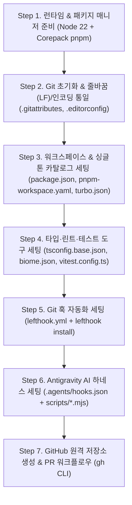

# 🛠️ 06. 루트 워크스페이스 및 AI 하네스 초기 세팅 A-to-Z 가이드 (`06-workspace-and-harness-setup-guide.md`)

> **문서 목적**: 빈 폴더에서 시작하여 이 MFE 스터디 프로젝트의 **루트 워크스페이스(`Phase 0`)와 AI 하네스·Git 훅·GitHub PR 환경**을 어떻게 구축했는지, 실제로 사용한 명령어와 각 설정 파일의 핵심 옵션을 빠짐없이 기록한 **실습·재현 교본**입니다.  
> 나중에 새로운 프로젝트를 세팅하거나 각 설정의 이유를 복기할 때 이 문서를 위에서 아래로 그대로 따라가면 동일하게 구축할 수 있습니다.

---

## 🧭 전체 초기 세팅 흐름도



---

## 1. 사전 런타임 및 패키지 매니저 세팅 (`Node.js 22` & `Corepack pnpm`)

### 1.1 왜 Node.js `v22.x`와 `pnpm`을 사용하는가?
- **Node.js `v22.5.0+` (권장 `v22.17.0+`)**: 백엔드(`apps/api-server`)에서 무거운 C++ 네이티브 빌드 도구(`node-gyp`, Visual Studio Build Tools)가 필요한 `better-sqlite3` 대신, **Node.js 공식 내장 모듈인 `node:sqlite`(`DatabaseSync`)**를 설치 없이 즉시 사용하기 위함입니다.
- **`pnpm@9.15.5`**: 심볼릭 링크 기반의 빠른 설치 속도와 **`catalog:`(중앙 버전 카탈로그)** 기능을 통해 모든 마이크로 앱의 `react`, `react-dom`, `@tanstack/react-query` 버전을 한 곳에서 고정하기 위함입니다.

### 1.2 실행한 세팅 명령어 (PowerShell)
```powershell
# 1. Node.js 버전 확인 (v22.5.0 이상 필수)
node -v

# 2. Corepack 활성화 (Node.js에 내장된 패키지 매니저 버전 관리자)
corepack enable

# 3. pnpm 9.15.5 버전 다운로드 및 즉시 활성화
corepack prepare pnpm@9.15.5 --activate

# 4. 활성화된 pnpm 버전 확인
pnpm -v
```

> **💡 트러블슈팅 메모 (`Cannot find module '.../corepack/v1/pnpm/.../pnpm.cjs'`)**:  
> Windows 환경에서 로컬 Corepack 캐시에 존재하지 않는 버전이 호출되어 에러가 날 때는 위와 같이 `corepack prepare pnpm@9.15.5 --activate`를 실행하고, 루트 [`package.json`](../../package.json)에 `"packageManager": "pnpm@9.15.5"`를 명시하면 해결됩니다.

---

## 2. Git 저장소 초기화 및 OS 간 줄바꿈(`LF`)·인코딩 통일 세팅

Windows(`CRLF`, `\r\n`)와 macOS/Linux(`LF`, `\n`) 환경 차이로 인해 포맷터(`Biome`)나 해시 검증 스크립트가 오작동하는 것을 원천 차단하기 위해 **Git 초기화 직후 3대 환경 파일**을 가장 먼저 생성합니다.

### 2.1 실행한 명령어
```powershell
# 기본 브랜치 이름을 main으로 지정하여 Git 저장소 초기화
git init -b main
```

### 2.2 생성한 3대 환경 설정 파일과 핵심 옵션 의미

| 파일명 | 핵심 설정 내용 | 왜 이 설정이 필요한가? |
| :--- | :--- | :--- |
| [`.gitattributes`](../../.gitattributes) | `* text=auto eol=lf` | Windows에서 작업하더라도 워킹 트리와 Git 저장소 모두 줄바꿈을 무조건 **`LF(\n)`**로 고정합니다. 특히 SQL 파일 해시(`SHA-256`) 비교 시 OS별 줄바꿈 차이로 해시가 깨지는 현상을 막아줍니다. |
| [`.editorconfig`](../../.editorconfig) | `charset = utf-8`<br>`end_of_line = lf`<br>`indent_size = 2` | 에디터(VS Code, Cursor, Antigravity 등)에서 새 파일을 생성하고 저장할 때 처음부터 `UTF-8` 인코딩과 `LF` 줄바꿈으로 저장되도록 강제합니다. |
| [`.gitignore`](../../.gitignore) | `node_modules/`<br>`dist/`<br>`*.db`<br>`temp/` | 빌드 산출물, SQLite 로컬 DB 파일(`*.db`), 그리고 전체 구축 완료 후 삭제할 초기 참조 문서 폴더(`temp/`)가 Git에 커밋되지 않도록 차단합니다. |

---

## 3. 워크스페이스 및 `pnpm catalog:` 싱글톤 버전 중앙 통제 세팅

### 3.1 [`pnpm-workspace.yaml`](../../pnpm-workspace.yaml) 작성 (`catalog:` 기능 활용)
MFE 환경에서 호스트와 리모트 앱의 `react`나 `@tanstack/react-query` 버전이 서로 다르면 런타임에 **싱글톤 협상 실패 또는 다중 인스턴스 로드(`Invalid Hook Call`)**가 발생합니다. 이를 방지하기 위해 루트 `pnpm-workspace.yaml`의 `catalog:`에 공통 버전을 정의합니다.

```yaml
packages:
  - "apps/*"

catalog:
  # MFE 런타임 싱글톤 필수 고정 패키지
  react: ^19.1.0
  react-dom: ^19.1.0
  "@types/react": ^19.1.2
  "@types/react-dom": ^19.1.2
  "@tanstack/react-query": ^5.74.4

  # 공통 표준 라이브러리
  "@ark-ui/react": ^5.10.0
  clsx: ^2.1.1
  ky: ^1.8.1
  react-hook-form: ^7.56.1
  "@hookform/resolvers": ^5.0.1
  zod: ^3.24.3
  date-fns: ^4.1.0
  es-toolkit: ^1.34.0
```
- **하위 앱에서 사용하는 법**: 이후 각 앱(`apps/remote-shared/package.json` 등)에서는 버전 숫자 대신 `"react": "catalog:"`라고만 적으면 루트 카탈로그의 버전이 자동으로 주입됩니다.

### 3.2 루트 [`package.json`](../../package.json) 및 [`turbo.json`](../../turbo.json) 구성
- **루트 `package.json` 주요 스크립트**:
  - `pnpm dev`: `turbo run dev --parallel` (6개 마이크로 서비스 동시 기동)
  - `pnpm build`: `turbo run build` (전체 앱 캐시 기반 병렬 빌드)
  - `pnpm test`: `vitest run` (단위 및 통합 테스트 실행)
  - `pnpm check`: `biome check .` (전체 코드 린트·포맷 검사)
  - `pnpm check:write`: `biome check --write .` (린트·포맷 자동 수정)
  - `pnpm sql:verify` / `pnpm sql:update`: `node scripts/verify-sql-sync.mjs` (백엔드 3종 SQL 해시 및 순차 실행 검증/갱신)
  - `pnpm smoke:phase1`: `node scripts/verify-mfe-smoke.mjs` (실제 6개 서버 기동 후 Module Federation 런타임 연결 검증)
- **[`turbo.json`](../../turbo.json) 주의사항**:
  - `Turborepo v2`부터는 구버전의 `"pipeline"` 키 대신 반드시 **`"tasks"`** 키를 사용해야 합니다.
  - `dev` 태스크는 개발 서버가 종료되지 않고 계속 떠 있어야 하므로 `"cache": false, "persistent": true` 옵션을 필수로 줍니다.

### 3.3 패키지 설치 실행 명령어
```powershell
pnpm install
```

---

## 4. TypeScript · Biome · Vitest 설정 및 실행 명령어

### 4.1 [`tsconfig.base.json`](../../tsconfig.base.json) (공통 TypeScript 설정)
모든 마이크로 앱이 `extends: "../../tsconfig.base.json"`으로 상속받아 사용하는 루트 설정입니다.
- **`"moduleResolution": "bundler"`**: Vite와 Rspack 같은 모던 번들러 환경에 최적화된 모듈 해석 방식을 사용합니다.
- **`"noUncheckedIndexedAccess": true`**: 배열이나 객체를 인덱스로 접근할 때(`items[0]`) 무조건 `T | undefined`로 추론하게 만들어 런타임 `Cannot read properties of undefined` 에러를 컴파일 타임에 방어합니다.
- **`"allowJs": true`**: 루트의 `.mjs` 하네스 스크립트를 `.ts` 테스트 코드에서 import할 때 JSDoc 타입을 인식할 수 있도록 허용합니다.

```powershell
# 루트 TypeScript 타입 체크 실행 명령어 (파일 생성 없이 에러만 검사)
pnpm exec tsc --noEmit -p tsconfig.base.json
```

### 4.2 [`biome.json`](../../biome.json) (초고속 통합 린터 & 포맷터)
기존의 복잡한 `ESLint + Prettier + eslint-config-prettier` 조합 대신, 설정 파일 1개로 린트와 포맷팅을 수행하는 **Biome**을 사용합니다.
- **`formatter.lineEnding: "lf"`**: 포맷팅 시 줄바꿈을 무조건 `LF`로 맞춥니다.
- **`javascript.formatter.quoteStyle: "single"`**: JS/TS 코드에서는 홑따옴표(`'`)를 기본으로 사용합니다.

```powershell
# 코드 린트 및 포맷 검사 (수정하지 않고 에러 여부만 확인)
pnpm check

# 코드 린트 및 포맷 자동 수정
pnpm check:write
```

### 4.3 [`vitest.config.ts`](../../vitest.config.ts) (단위·통합 테스트 러너)
```powershell
# 전체 테스트 1회 실행 (CI 및 Git 훅용)
pnpm test
```

---

## 5. Git 훅 자동화 세팅 (`Lefthook`)

개발자나 AI 에이전트가 실수로 포맷팅이 깨진 코드나 다른 서비스 폴더를 건드린 코드를 커밋·푸시하지 못하도록 **Lefthook**으로 Git 훅을 자동화했습니다.

### 5.1 [`lefthook.yml`](../../lefthook.yml) 동작 구조
1. **`pre-commit` (`git commit` 실행 직전 자동 작동)**:
   - `biome-check`: 스테이징된 파일(`{staged_files}`)을 자동으로 포맷팅하고 다시 스테이징(`stage_fixed: true`)합니다.
   - `scope-check`: `node scripts/verify-scope.mjs`를 실행하여 `.agents/active-scope.json`에 허용된 서비스 폴더 외의 파일이 수정되었으면 커밋을 차단합니다.
2. **`pre-push` (`git push` 실행 직전 자동 작동)**:
   - `biome-check` (전체 코드 검사) + `sql-sync-check` (3종 SQL 무결성 검증) + `unit-test` (`pnpm test`) 3가지를 병렬(`parallel: true`)로 실행하여 하나라도 실패하면 원격 푸시를 차단합니다.

### 5.2 실행한 Lefthook 활성화 명령어 (중요!)
`lefthook.yml` 파일만 만든다고 Git 훅이 바로 동작하지 않습니다. 반드시 아래 명령어로 `.git/hooks/` 내부에 훅 실행 파일을 설치해야 합니다.
```powershell
# .git/hooks 폴더에 pre-commit, pre-push 훅 등록
pnpm exec lefthook install
```

---

## 6. Antigravity AI 워크플로우 하네스 세팅 (`.agents/` & `scripts/`)

AI 에이전트가 헌법([`GEMINI.md`](../../GEMINI.md))을 잊어버리지 않고 5단계 TDD와 스코프 격리를 강제 수행하도록 만드는 장치입니다.

### 6.1 구성 파일 요약
1. **[`.agents/active-scope.json`](../../.agents/active-scope.json)**:
   - 현재 작업 중인 스코프(`scope`), 허용된 폴더 경로(`allowedPaths`), 브랜치명(`branch`), 현재 TDD 단계(`currentStep: 1~5`)를 기록하는 상태 잠금 파일입니다.
2. **[`.agents/hooks.json`](../../.agents/hooks.json)**:
   - Antigravity 에이전트의 5대 생명주기(`SessionStart`, `PreInvocation`, `PreToolUse`, `PostToolUse`, `Stop`)마다 실행할 Node.js 스크립트를 연결합니다.
   - **⚠️ 핵심 주의사항 (상대 경로)**: Antigravity가 `.agents/hooks.json`에 등록된 명령어를 실행할 때 **현재 작업 디렉토리(`CWD`)는 루트가 아니라 `.agents/` 폴더**입니다. 따라서 명령어는 반드시 `"node ../scripts/<스크립트명>.mjs"`처럼 상위 폴더(`../`)를 가리켜야 합니다.
3. **하네스 스크립트 (`scripts/*.mjs`)**:
   - [`inject-context.mjs`](../../scripts/inject-context.mjs): 매 턴마다 현재 스코프, TDD 단계별 권장 모델(`Argon High` ↔ `Argon Medium`), `todo.md` 요약을 에이전트에게 자동 주입(`ephemeralMessage`)합니다.
   - [`verify-scope.mjs`](../../scripts/verify-scope.mjs): 파일 수정 도구 호출 전 허용된 스코프 밖의 경로 수정을 차단합니다.
   - [`verify-todo-before-merge.mjs`](../../scripts/verify-todo-before-merge.mjs): `git merge` 실행 전 `todo.md`가 업데이트되었는지 확인합니다.
   - [`auto-format.mjs`](../../scripts/auto-format.mjs): 파일 저장 직후 `Biome` 포맷팅을 자동 실행합니다.
   - [`verify-sql-sync.mjs`](../../scripts/verify-sql-sync.mjs): 백엔드 3종 SQL 파일의 해시 일치 여부와 인메모리 SQLite(`node:sqlite`) 순차 실행(`01 -> 02 -> 03 -> 01`)을 검증합니다.
   - [`verify-stop-gate.mjs`](../../scripts/verify-stop-gate.mjs): 에이전트가 턴을 종료하기 전 `Biome`, `tsc`, `Vitest`, `SQL` 검증을 통과했는지 최종 점검합니다.

---

## 7. GitHub CLI (`gh`) 원격 저장소 생성 및 PR 워크플로우 명령어

터미널에서 브라우저 이동 없이 GitHub 원격 저장소를 만들고 PR을 생성할 때 사용한 명령어들입니다.

```powershell
# 1. GitHub CLI 로그인 및 권한 상태 확인
gh auth status

# 2. GitHub 공개(Public) 원격 저장소 생성
gh repo create dev-HongCheol/mfe-study --public --description "Micro Frontend (MFE) Polyrepo-ready Architecture & AI Harness TDD Study Testbed"

# 3. 생성된 GitHub 저장소를 로컬 Git의 origin 원격 저장소로 등록
git remote add origin https://github.com/dev-HongCheol/mfe-study.git
git remote -v

# 4. 기본 main 브랜치 및 작업 브랜치를 원격(origin)으로 푸시
git push -u origin main
git push -u origin root/chore/init-workspace-harness

# 5. 작업 브랜치에서 main 브랜치로 향하는 GitHub PR 생성
gh pr create --base main --head root/chore/init-workspace-harness --title "feat(root): Phase 0 루트 워크스페이스 설정 및 AI TDD 하네스 구축" --body-file <PR본문파일경로>
```

---

## 8. [부록] 처음부터 끝까지 순서대로 실행하는 세팅 명령어 치트시트

빈 폴더에서 동일한 루트 환경을 구축할 때 복사해서 순서대로 실행할 수 있는 요약본입니다.

```powershell
# Step 1. Node 22 확인 및 Corepack pnpm 9.15.5 활성화
node -v
corepack enable
corepack prepare pnpm@9.15.5 --activate

# Step 2. Git 초기화 (.gitattributes, .editorconfig, .gitignore 작성 후)
git init -b main

# Step 3. 루트 package.json, pnpm-workspace.yaml, turbo.json 작성 후 의존성 설치
pnpm install

# Step 4. Lefthook Git 훅(.git/hooks) 실제 설치
pnpm exec lefthook install

# Step 5. 코드 포맷·린트·타입·단위 테스트 전체 검증 실행
pnpm check
pnpm exec tsc --noEmit -p tsconfig.base.json
pnpm test

# Step 6. GitHub 원격 저장소 생성 및 푸시
gh repo create dev-HongCheol/mfe-study --public
git remote add origin https://github.com/dev-HongCheol/mfe-study.git
git push -u origin main
```

---

> **📌 향후 서비스별 세팅 명령어 누적 안내**:  
> `Phase 1`부터 진행되는 각 마이크로 서비스(`apps/api-server`, `apps/remote-shared`, `apps/remote-products`, `apps/remote-cart`, `apps/host-vite`, `apps/host-rspack`) 구축 시에도, 각 브랜치에서 사용한 패키지 설치·번들러(Vite / Rspack) 세팅·실행 명령어를 스터디 문서에 동일하게 기록하여 언제든 혼자서도 재현할 수 있도록 관리합니다.
