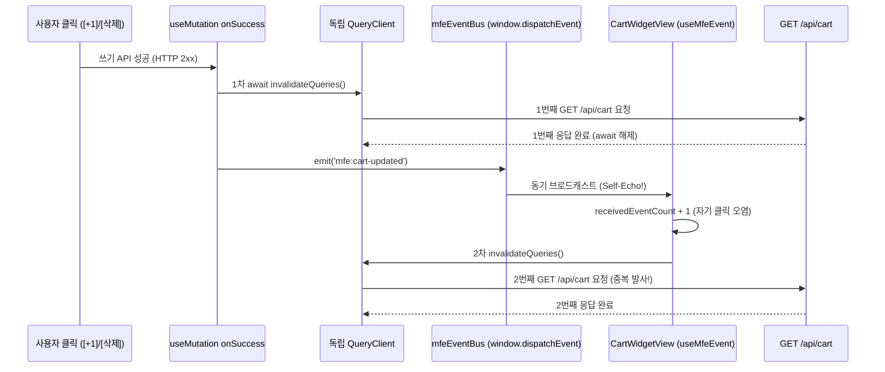
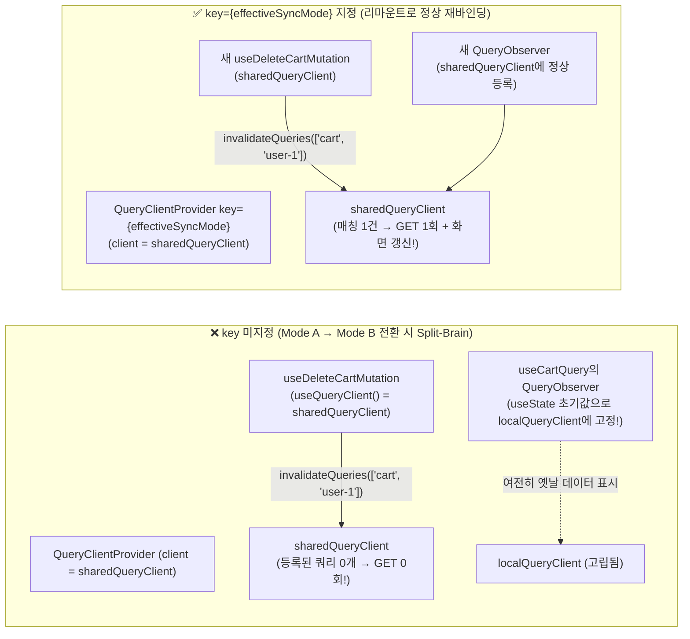

# Study 12. MFE `Mode A` 이벤트 자기 에코(Self-Echo) 차단(`sourceId` 표준 패턴)과 `QueryClient` 단위 상태 동기화 아키텍처

> **문서 목적**: `React 19 + TanStack Query v5 + Module Federation + Zod + window.CustomEvent` 기반의 `Mode A (mode-a-event)` 상태 동기화에서 발생하는 **자기 에코(Self-Echo) 중복 `invalidateQueries` 문제**를 분석하고, 현업 MFE 표준인 **`mfeEventBus` 발신자 식별(`sourceId` / `ignoreSourceId`) 패턴**과 **`QueryClient` 단위 단일 리스너 채널**을 결합한 최종 아키텍처를 정리한 영구 학습·구현 정본입니다.
>
> **현재 적용 상태 및 2단계 로드맵**:
> - **1차 (`Scope: shared` | `Branch: shared/feat/event-bus-source-id`, PR #16 완료)**: `remote-shared/utils`의 `mfeEventBus`·`useMfeEvent`에 선택적 `{ sourceId }` / `{ ignoreSourceId }` 자동 필터링, `MfeEventMeta`, `createMfeEventSourceId(prefix)` 추가 완료
> - **2차 (`Scope: cart` | `Branch: cart/refactor/queryclient-sync-channel`)**: `apps/remote-cart`에서 `QueryClient`별 고유 `sourceId` + 단일 리스너 채널 적용 및 8대 회귀 테스트 구축 *(1차 머지 직후 진행)*
> - **호스트 2종(`host-vite`, `host-rspack`) 및 향후 모든 MFE**: [`Study 04 #09`](./04-mfe-real-world-pitfalls-and-solutions.md) 트러블슈팅 체크리스트를 통해 동일한 `sourceId` 패턴을 1줄로 재사용
>
> **관련 문서**:
> - MFE `Mode A vs Mode B` 비교 학습 개념: [Study 01. MFE 개념 및 핵심 원리 가이드](./01-mfe-concepts-and-guide.md)
> - MFE 좀비 이벤트 리스너 및 자기 에코 트러블슈팅: [Study 04. MFE 14대 실전 고유 이슈와 해결 아키텍처 (`#09`)](./04-mfe-real-world-pitfalls-and-solutions.md)
> - 비동기 경쟁 상태(Race Condition) 및 `AbortSignal` 방어: [Study 05. 풀스택 서비스 구현 16대 실전 이슈](./05-fullstack-service-real-world-issues.md), [Study 08. AbortController · AbortSignal 패턴](./08-abort-signal-and-async-cancellation.md)

---

## 1. 문제 배경 및 발생 메커니즘 (Self-Echo + 중복 네트워크 호출)

### 1.1 MFE 동기화 비교 모드 전제
우리 프로젝트는 마이크로 앱 간 서버 상태 동기화 방식을 비교 학습하기 위해 두 모드를 대칭적으로 유지합니다.

| 모드 | 캐시(`QueryClient`) 소유 | 동기화 수단 | 이벤트 발행/구독 |
| :--- | :--- | :--- | :--- |
| **Mode A (`mode-a-event`)** | 리모트(위젯)별 독립 `QueryClient` | `window.CustomEvent` 기반 `mfeEventBus` | **발행 및 구독 수행** (약결합) |
| **Mode B (`mode-b-query`)** | 싱글톤 `sharedQueryClient` 공유 | `sharedQueryClient.invalidateQueries` | **발행·구독 모두 0회** |

`apps/remote-shared`의 이벤트 버스(`mfeEventBus`)는 다음 두 가지 특성을 가집니다.
1. **Zod 런타임 검증 및 `strip` 기본 동작**: `emit()`과 `subscribe()` 양쪽에서 `MFE_EVENT_SCHEMAS`로 `safeParse()`를 실행하며, `z.object()` 기본 동작(`strip`)에 따라 선언되지 않은 키는 결과 객체에서 자동 제거됩니다.
2. **동기(Synchronous) DOM 이벤트 디스패치**: 브라우저 DOM 표준상 `window.dispatchEvent(new CustomEvent(...))`는 태스크 큐에 넣지 않고 현재 콜스택에서 등록된 모든 리스너를 즉시 순차 실행합니다.

### 1.2 `GET /api/cart`가 2번 호출되는 원인 (`Step 1.4` 초기 구현)

`apps/remote-cart`처럼 **같은 이벤트를 발행하면서 동시에 구독하는 컴포넌트**(또는 향후 양방향 동기화를 수행하는 호스트 2종)에서는 아래 연쇄가 발생합니다.

```ts
// 1) 쓰기 뮤테이션 성공 시 (문제 시점 구현)
await queryClient.invalidateQueries({ queryKey: CART_QUERY_KEY }); // 1번째 GET /api/cart (완료까지 await)
if (syncMode === 'mode-a-event') {
  mfeEventBus.emit(MFE_EVENTS.CART_UPDATED, eventPayload);         // 직후 동기 이벤트 발행
}

// 2) 같은 앱 내부의 이벤트 구독 리스너 (문제 시점 구현)
useMfeEvent(MFE_EVENTS.CART_UPDATED, (payload) => {
  // 자기가 발행한 이벤트인데도 되받아서(Self-Echo) 외부 수신 카운터 오염 + 2번째 GET 발사!
  setReceivedEventCount((prev) => prev + 1);
  void activeQueryClient.invalidateQueries({ queryKey: CART_QUERY_KEY });
});
```



- **핵심 문제 2가지**:
  1. **불필요한 중복 네트워크 요청**: `await invalidateQueries`가 끝난 직후 `emit`이 호출되므로 TanStack Query의 요청 중복 제거(in-flight deduplication)마저 빗나가 **항상 실제 `GET /api/cart`가 2번 연달아 호출**됩니다.
  2. **관측 지표(`receivedEventCount`) 오염**: 외부 앱(`remote-products` 등)에서 온 신호만 세어야 하는 배지가 자기 버튼 클릭 때마다 증가합니다.

---

## 2. 현업·브라우저 표준 대안 비교 및 최종 채택 근거

### 2.1 현업 및 커뮤니티 주요 해법 5종 비교

| 대안 | 핵심 메커니즘 | 장점 | 한계 / 트레이드오프 |
| :--- | :--- | :--- | :--- |
| **대안 1. `mfeEventBus` 발신자 식별(`sourceId`) 예약 메타 키 + `QueryClient` 단위 단일 리스너 채널 *(최종 채택)*** | `emit(..., { sourceId })`로 `CustomEvent.detail`에 `__mfeSourceId` 메타 첨부, `subscribe(..., { ignoreSourceId })`가 Zod 파싱 전 1줄 차단(`if (sourceId === ignoreSourceId) return;`) | 1) **현업 MFE(ThoughtWorks, `mitt`/`RxJS` 래퍼) 압도적 표준**<br>2) **도메인 Zod 스키마 무변경 & 구버전·신버전 양방향 100% 하위 호환**(`Zod strip` 활용)<br>3) **`remote-cart` + 호스트 2종(`host-vite`/`host-rspack`) 모두 1줄로 공짜 재사용**<br>4) 동기(`CustomEvent`)·비동기(`BroadcastChannel`) 모두 동일 동작<br>5) `MfeInspector`가 `meta.sourceId`로 발신 출처까지 로그 추적 가능 | 최하위 공통 모듈 `remote-shared/utils`에 소규모 확장 PR 1건 선행 필요 *(본 프로젝트는 직접 관리하므로 제약 없음)* |
| **대안 2. 브라우저 네이티브 `BroadcastChannel` API** | `new BroadcastChannel('mfe-cart')`를 클라이언트별 생성 (`postMessage`는 MDN 스펙상 발신 인스턴스 자신에게 미전달) | Zero-Library 자기 에코 자동 차단 + 멀티 탭 동기화 공짜 | `CustomEvent` 기반 `Mode A` 학습 컨셉과 결이 다르고, 비동기 Task Queue 실행·`jsdom` 폴리필/디버깅 고려 필요 |
| **대안 3. `@tanstack/query-broadcast-client-experimental`** | `BroadcastChannel` + `let transaction = false` 락으로 타 `QueryClient`에 `query.setState()` 직접 복제 | 재조회 없이 캐시 직접 동기화 | `Mode A`(`CustomEvent` 재조회) vs `Mode B`(`sharedQueryClient`) 비교 학습 목적에 맞지 않음 |
| **대안 4. `remote-cart` 단독 `selfEchoTokens` 동기 스택 우회** | `remote-shared` 무수정 전제로, 동기 `dispatchEvent` 도중 페이로드 7개 필드를 스택 비교해 1회 소비 | 타 팀 소유 `remote-shared`를 절대 수정 못 할 때 단독 우회 가능 | 코드 복잡도 높음, 동기 디스패치 전제에 강하게 결합, 호스트 2종에서 재사용 불가 |
| **대안 5. `mitt` / `EventEmitter3` / `RxJS` 라이브러리 교체** | 서드파티 이벤트 버스 라이브러리 도입 | 유틸리티 API 풍부 | 자기 에코 차단 기능은 내장되어 있지 않아 결국 **대안 1(`sourceId` 필터링)**을 한 겹 감싸야 함 |

### 2.2 왜 `CustomEvent.detail`을 `{ payload, meta }`로 감싸지 않고 `__mfeSourceId` 예약 키를 쓰는가?
- 만약 `detail` 전체를 `{ payload, meta }`로 감싸면 구버전 리모트(`schema.safeParse(event.detail)`)나 `event.detail`을 직접 읽는 외부 코드가 즉시 파싱 실패합니다.
- 반면 평문 도메인 객체에 예약 메타 키 `__mfeSourceId`만 선택적으로 첨부하면 **4가지가 동시에 성립**합니다:
  1. **신버전 발신 → 신버전 수신**: `subscribe`가 `safeParse` **전**에 `__mfeSourceId`를 추출해 `ignoreSourceId` 일치 시 즉시 차단하고, 통과 시 `Zod` 기본 `strip`이 `__mfeSourceId`를 자동 제거해 핸들러에는 **순수 도메인 페이로드(`parsed.data`)** + 선택적 두 번째 인자 `meta?: { sourceId?: string }`로 전달합니다.
  2. **신버전 발신 → 구버전 수신**: 구버전 `z.object().safeParse()`가 알 수 없는 키 `__mfeSourceId`를 에러 없이 자동 제거(`strip`)해 정상 동작합니다.
  3. **구버전 발신(`remote-products` 등) → 신버전 수신**: `__mfeSourceId`가 없으므로 필터링에 걸리지 않고 `handler(parsed.data)` 1개 인자로 호출되어 기존 소비자·테스트(`toHaveBeenCalledWith(payload)`)가 단 1건도 깨지지 않습니다.
  4. **직렬화·비동기 확장 100% 호환**: 순수 문자열 키이므로 향후 `BroadcastChannel`이나 `postMessage`로 전송 계층을 교체해도 `sourceId`가 손실되지 않습니다.

---

## 3. 최종 채택 아키텍처 (4대 원칙 & 2계층 구현 레퍼런스)

### 3.1 핵심 아키텍처 4대 원칙
1. **발신자 식별(`sourceId`)의 공통화**: 모든 MFE 앱·위젯·호스트는 `remote_shared/utils`의 `createMfeEventSourceId(prefix)`로 고유 ID를 발급하고, `emit(..., { sourceId })` / `subscribe(..., { ignoreSourceId })` (또는 `useMfeEvent`)를 사용해 자기 에코를 이벤트 버스 경계에서 1줄로 차단합니다.
2. **동기화 소유 단위 = `QueryClient`**: 장바구니처럼 캐시(`QueryClient`)를 가진 도메인 앱은 `QueryClient` 인스턴스당 고유 `sourceId` 1개와 이벤트 리스너 최대 1개(`Ref-Counting`)를 부여합니다.
3. **`emit` 선행(`try/catch` 격리) → `await invalidateQueries` 1회**: 쓰기 API(`onSuccess`)는 이미 DB 커밋 완료 시점이므로, 타 `QueryClient`에 이벤트를 먼저 알리고(외부 리스너 예외 격리) 로컬 `QueryClient`는 `await invalidateQueries({ queryKey: [...CART_QUERY_KEY, userId] })`를 정확히 1회 수행합니다.
4. **`Mode A` / `Mode B` 완전 격리**: `Mode B`에서는 이벤트 구독(`enabled: false`)과 발행을 모두 `0회`로 유지합니다.

### 3.2 1차 구현 (`apps/remote-shared` — `event-bus.ts` 공개 계약)

```ts
// apps/remote-shared/src/features/utils/model/event-bus.ts (1차 PR 핵심 시그니처)
export interface MfeEventEmitOptions {
  /** 이벤트를 발행하는 앱·위젯·QueryClient 인스턴스의 고유 발신자 ID */
  sourceId?: string;
}

export interface MfeEventSubscribeOptions {
  /** 이 ID와 일치하는 sourceId로 발행된 자기 이벤트(Self-Echo)를 수신 단계에서 자동 무시합니다. */
  ignoreSourceId?: string;
}

export interface MfeEventMeta {
  /** 발신 측이 emit 옵션으로 전달한 고유 발신자 ID */
  sourceId?: string;
}

export function createMfeEventSourceId(prefix: string): string;
```

- **호스트 2종(`host-vite`, `host-rspack`) 재사용 예시 (단 2줄!)**:
  ```ts
  const hostSourceId = useMemo(() => createMfeEventSourceId('host-vite'), []);

  // 호스트가 이벤트를 발행할 때
  mfeEventBus.emit(MFE_EVENTS.AUTH_CHANGED, payload, { sourceId: hostSourceId });

  // 호스트가 같은 이벤트를 구독할 때 (자기 에코 자동 차단!)
  useMfeEvent(MFE_EVENTS.AUTH_CHANGED, handleExternalAuthChange, {
    ignoreSourceId: hostSourceId,
  });

  // 호스트 MfeInspector가 모든 앱의 이벤트를 출처까지 감시할 때 (ignoreSourceId 미지정)
  useMfeEvent(MFE_EVENTS.CART_UPDATED, (payload, meta) => {
    appendLog({ event: 'mfe:cart-updated', from: meta?.sourceId ?? 'unknown', payload });
  });
  ```

- **실전 보충 — `createMfeEventSourceId`와 트랜스파일링 vs 폴리필 vs 런타임 폴백 (`Web Crypto Secure Context` 함정)**:
  - `Vite(esbuild)`·`Rspack(SWC)`의 `build.target` 설정(`chrome89` 등)은 `?.`, `??`, `JSX` 같은 **JS 문법(Syntax)을 번역(트랜스파일링)**할 뿐, `crypto.randomUUID()` 같은 **브라우저 내장 Web API(폴리필 대상)**를 자동으로 채워 넣지 않습니다.
  - 특히 `crypto.randomUUID()`는 **Chrome 92+**부터 지원될 뿐만 아니라, Web Crypto API 보안 스펙상 **보안 컨텍스트(`https://` 또는 `http://localhost`)에서만 활성화**됩니다. 즉, 최신 Chrome 브라우저라도 사내 테스트 서버나 모바일 LAN 환경처럼 **`http://192.168.x.x:3000` 비보안 HTTP 주소로 접속하면 `crypto.randomUUID` 자체가 `undefined`로 사라져 `TypeError` 크래시**가 발생합니다.

  | 개념 | 대상 | 대표 예시 | `Vite`/`Rspack` 기본 `target` 설정으로 자동 해결되나? |
  | :--- | :--- | :--- | :---: |
  | **트랜스파일링 (Transpiling)** | 새로운 **JS 문법(Syntax)** 번역 | `?.`, `??`, `class`, `async/await`, `JSX` | ✅ **자동 번역됨** (`esbuild` / `SWC`) |
  | **폴리필 (Polyfill)** | 구형 브라우저에 없는 **내장 API·메서드** 구현체 주입 | `crypto.randomUUID()`, `Array.prototype.at()`, `structuredClone()` | ❌ **자동 주입 안 됨** (`core-js`, `@vitejs/plugin-legacy` 등 별도 설정 필요) |
  | **런타임 폴백 (Fallback)** | 구형 브라우저 + **최신 브라우저의 `http://IP` 비보안 컨텍스트(`Secure Context`) 제약** 방어 | `typeof globalThis.crypto?.randomUUID === 'function' ? ... : fallback` | 코드에서 직접 분기 처리 (가장 가볍고 안전) |

  - 이에 따라 `createMfeEventSourceId`는 `https://`/`localhost`에서는 표준 `crypto.randomUUID()`를 우선 사용하고, 미지원 환경(사내 `http://IP`, `Chrome 89~91`, 일부 테스트 런타임)에서는 단조 증가 시퀀스 + 타임스탬프 폴백(`fallback-<seq>-<ts>`)으로 안전하게 동작하도록 방어합니다.

### 3.3 2차 구현 (`apps/remote-cart` — `cart-sync-channel.ts` 단순화 레퍼런스)

1차 PR에서 `mfeEventBus`가 `sourceId` 필터링을 내장함에 따라, 2차 PR(`cart/refactor/queryclient-sync-channel`)의 `cart-sync-channel.ts`는 복잡한 `selfEchoTokens` 스택·페이로드 7개 필드 비교 없이 **약 절반 분량의 명쾌한 코드**로 단순화됩니다:

```ts
// apps/remote-cart/src/features/cart/model/cart-sync-channel.ts (2차 PR 기준 설계)
import type { QueryClient } from '@tanstack/react-query';
import { useEffect, useSyncExternalStore } from 'react';
import {
  CART_QUERY_KEY,
  type CartUpdatedEventPayload,
  MFE_EVENTS,
  type SyncMode,
  createMfeEventSourceId,
  mfeEventBus,
} from 'remote_shared/utils';

interface CartSyncChannel {
  /** 이 QueryClient 인스턴스 전용 고유 발신자 ID (자기 에코 차단 키) */
  sourceId: string;
  /** 현재 이 QueryClient에서 구독 중인 userId별 활성 위젯 참조 수 */
  users: Map<string, number>;
  /** 외부 이벤트 수신으로 실제 캐시 무효화가 발생한 userId별 누적 횟수 */
  receivedCountByUser: Map<string, number>;
  /** QueryClient당 최대 1개의 mfeEventBus 구독 해제 함수 */
  unsubscribe?: () => void;
  /** useSyncExternalStore 알림 리스너 집합 */
  listeners: Set<() => void>;
}

const REGISTRY_SYMBOL = Symbol.for('mfe-study.remote-cart.sync-channels');

// 1) subscribeCartSync(qc, userId):
//    ch.unsubscribe = mfeEventBus.subscribe(
//      MFE_EVENTS.CART_UPDATED,
//      (payload) => { /* users 확인 -> receivedCountByUser +1 -> qc.invalidateQueries(['cart', payload.userId]) */ },
//      { ignoreSourceId: ch.sourceId }, // 👈 단 1줄로 자기 에코 완전 차단!
//    );

// 2) syncCartAfterMutation(qc, mode, payload):
//    if (mode === 'mode-a-event') {
//      try {
//        mfeEventBus.emit(MFE_EVENTS.CART_UPDATED, payload, { sourceId: getChannel(qc).sourceId });
//      } catch (error) {
//        console.error('[remote-cart] mfe:cart-updated 발행 중 리스너 오류:', error);
//      }
//    }
//    await qc.invalidateQueries({ queryKey: [...CART_QUERY_KEY, payload.userId] });
```

### 3.4 쿼리 키 구조 정렬 및 공식 스펙 근거 (`TanStack Query v5` · `React 19`)
1. **쿼리 키 정렬**: `['cart', { userId, apiBaseUrl, simulateDelay }]` → **`['cart', userId, { apiBaseUrl, simulateDelay }]`**
   - `TanStack Query v5`의 `invalidateQueries({ queryKey: ['cart', userId] })`와 `cancelQueries({ queryKey: ['cart', userId] })`는 기본값 `exact: false`(prefix 매칭)로 동작하므로 해당 사용자의 옵션 조합을 모두 갱신하면서 타 사용자 캐시는 격리합니다.
   - `Mode B`에서 `remote-products`가 호출하는 `sharedQueryClient.invalidateQueries({ queryKey: ['cart'] })`와도 100% 하위 호환됩니다.
2. **React 19 `<StrictMode>` & `useSyncExternalStore`**:
   - Ref-Counting(`users: Map<string, number>`) + 멱등 클린업(`let disposed = false`)으로 `<StrictMode>` 이중 마운트에도 좀비 리스너가 `0개`이며, `useSyncExternalStore`로 동일 `QueryClient` + 동일 `userId` 위젯 간 `receivedEventCount`가 100% 일치합니다.

### 3.5 실전 함정 — `Mode A ↔ Mode B` 전환 시 `<QueryClientProvider>`의 `QueryClient` 교체와 `QueryObserver` Split-Brain (`key` 리마운트 해결)

실제 브라우저에서 `Mode A (localQueryClient)`로 초기 마운트한 뒤 드롭다운으로 `Mode B (sharedQueryClient)`로 전환하고 `[장바구니 비우기]`나 `[+1]`을 클릭했을 때, **백엔드 `DELETE /api/cart/all`은 `200 OK`로 성공했는데도 직후 `GET /api/cart`가 호출되지 않고 이전 상품이 화면에 그대로 남는 장애**가 발생합니다.

#### 1) 원인: `TanStack Query v5` 내부 `Observer`의 `useState` 영구 바인딩
`@tanstack/react-query` v5의 `useBaseQuery.js`와 `useMutation.js` 내부 구현을 보면 다음과 같습니다.

```js
// @tanstack/react-query/build/modern/useBaseQuery.js
const client = useQueryClient(queryClient);
const [observer] = React.useState(() => new Observer(client, defaultedOptions));

// @tanstack/react-query/build/modern/useMutation.js
const client = useQueryClient(queryClient);
const [observer] = React.useState(() => new MutationObserver(client, options));
```

- **`QueryClient`** = API 캐시를 보관하는 **캐시 창고** (`Mode A`의 `localQueryClient` = 개인 창고, `Mode B`의 `sharedQueryClient` = 공용 창고).
- **`QueryObserver`** = `useQuery`가 내부적으로 고용해 특정 `QueryClient`의 쿼리 키 변화를 감시하는 **창고 감시원**.
- `React.useState(() => ...)`는 **컴포넌트가 처음 마운트될 때 딱 1번만 실행**되므로, 부모가 `<QueryClientProvider client={activeQueryClient}>`의 `client` prop만 `localQueryClient → sharedQueryClient`로 교체하고 하위 컴포넌트를 그대로 유지하면 **Split-Brain(창고 불일치)**이 발생합니다:
  1. **`useCartQuery`의 `QueryObserver`**: 최초 마운트 때 잡힌 **옛날 `localQueryClient`**에만 영구 고정되어 있음 (`sharedQueryClient`에는 `['cart', 'user-1']` 키가 **등록조차 안 됨**).
  2. **뮤테이션 훅 내부의 `useQueryClient()`**: 매 렌더링마다 최신 Context를 읽으므로 **새 `sharedQueryClient`**를 반환함.
  3. **`[장바구니 비우기]` 실행**: `DELETE 200 OK` 성공 후 `sharedQueryClient.invalidateQueries({ queryKey: ['cart', 'user-1'] })`를 호출하지만, `sharedQueryClient`에는 구독 중인 감시원이 `0명`이므로 **`GET /api/cart` 호출 `0회`**, 화면은 `localQueryClient`의 옛날 데이터를 그대로 유지.



#### 2) 해결책: `<QueryClientProvider key={effectiveSyncMode} client={activeQueryClient}>`
React에서 단일 컴포넌트에 `key`를 부여하는 것은 **"상태와 인스턴스를 완전히 새로 교체(Reset)"**하기 위한 공식 패턴입니다.

```tsx
// apps/remote-cart/src/exposed/CartWidget.tsx
return (
  <QueryClientProvider key={effectiveSyncMode} client={activeQueryClient}>
    <CartWidgetView
      userId={effectiveUserId}
      hostType={hostType}
      syncMode={effectiveSyncMode}
      simulateDelay={simulateDelay}
      delayMs={delayMs}
      apiBaseUrl={apiBaseUrl}
    />
  </QueryClientProvider>
);
```

- `effectiveSyncMode`가 `'mode-a-event'` ↔ `'mode-b-query'`로 바뀌면 React가 기존 트리를 **완전히 언마운트(옛날 `QueryObserver` 구독 해제 및 임시 UI 상태 초기화)**하고, 새 `activeQueryClient`에 맞춰 **처음부터 새로 마운트**하여 `useQuery`·`useMutation`의 `Observer`를 새 `QueryClient`에 정식 바인딩합니다.
- **전사 MFE 체크리스트**: 런타임 중 `QueryClient` 인스턴스를 동적으로 교체하는 모든 마이크로 앱(`remote-cart`, `remote-products`, 향후 호스트 2종)은 반드시 `<QueryClientProvider key={effectiveSyncMode} client={activeQueryClient}>`를 적용해야 합니다.

---

## 4. 2차 PR (`remote-cart`) 8대 회귀 테스트 매트릭스 (3지표 분리 검증)

2차 PR(`cart/refactor/queryclient-sync-channel`)에서 단위 테스트(`cart-sync-channel.test.ts`)와 통합 테스트(`CartWidget.integration.test.tsx`)는 **`receivedEventCount`(화면 배지)**, **`invalidateQueries` 호출 횟수**, **MSW 실제 `GET /api/cart` 호출 횟수** 3가지 지표를 분리해 검증합니다.

| # | 테스트 시나리오 | 기대 `receivedEventCount` | 기대 `invalidateQueries` | 기대 실제 `GET /api/cart` |
| :-: | :--- | :--- | :--- | :--- |
| 1 | **단일 위젯 자기 뮤테이션 (`Mode A`)** | `0회` 유지 (자기 에코 차단) | 초기 이후 **정확히 1회** | 초기 1 + 재조회 **1 = 총 2회** |
| 2 | **동일 `QueryClient` 공유 위젯 2개 (`Mode A`)** — 외부 이벤트 1회 | 두 위젯 **모두 `1회`** 일치 | **정확히 1회** (리스너 1개 불변식) | 초기 1 + 재조회 **1 = 총 2회** |
| 3 | **독립 `QueryClient` 위젯 2개 A·B (`Mode A`)** — A가 `[+1]` 클릭 | A=`0회`, **B=`1회`** | A=1회, B=1회 (각각 1회) | 초기 2 + A 1 + B 1 = **총 4회** (5회 아님) |
| 4 | **같은 `userId` 위젯 2개 중 1개만 언마운트** 후 외부 이벤트 1회 | 남은 위젯 `+1회` | **1회** (조기 해제 없음) | `+1회` (2개 모두 해제 후 `0회`) |
| 5 | **React 19 `<StrictMode>` 마운트/재마운트** 후 외부 이벤트 1회 | `1회` (중복 없음) | **1회** (좀비 리스너 0) | 재조회 **1회** |
| 6 | **중첩 동기 이벤트 발행** (A 발행 중 외부 리스너가 다른 `sourceId`로 동기 `emit`) | 중첩 외부 이벤트 **정상 `+1회`** | 중첩 외부 이벤트 **정상 1회** | 중첩 대상 **정상 재조회** |
| 7 | **빠른 연속 뮤테이션** (`[+1]` 직후 `[장바구니 비우기]` / 지연 응답 엇갈림) | `0회` | 각 성공당 1회 (`cancelRefetch: true`) | 최종 화면·캐시가 **서버 최종 상태와 일치** |
| 8 | **Mode A ↔ Mode B 전환** (`QueryObserver` 재바인딩 포함) | A→B 전환 후 외부 이벤트 시 `0회` | Mode B 외부 이벤트 무효화 `0회`, 자기 뮤테이션(`[+1]`/`[장바구니 비우기]`) `sharedQueryClient` 각 1회 + `emit` `0회` | Mode B 외부 이벤트 시 `GET` `0회`, `[+1]`·`[장바구니 비우기]` 시 각 **실제 `GET` 1회 + 화면 즉시 갱신** |
