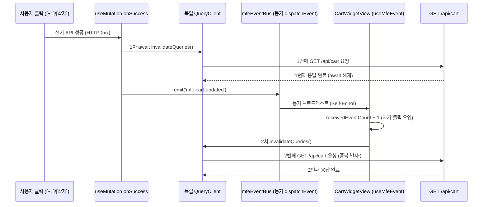

# Study 12. MFE `Mode A` 이벤트 자기 에코(Self-Echo)와 `QueryClient` 단위 상태 동기화 아키텍처

> **문서 목적**: `React 19 + TanStack Query v5 + Module Federation + Zod + window.CustomEvent` 기반의 `Mode A (mode-a-event)` 상태 동기화에서 발생한 **자기 에코(Self-Echo) 중복 `invalidateQueries` 문제**를 깊이 있게 해부하고, 단순 우회가 아닌 **`QueryClient` 단위 동기화 채널 아키텍처**로 해결하기 위한 전체 배경·반례 검증·최종 구현 레퍼런스·회귀 테스트 계획을 정리한 영구 학습 및 후속 구현 정본입니다.
>
> **관련 문서**:
> - MFE `Mode A vs Mode B` 비교 학습 개념: [Study 01. MFE 개념 및 핵심 원리 가이드](./01-mfe-concepts-and-guide.md)
> - MFE 좀비 이벤트 리스너 및 공유 상태 이슈: [Study 04. MFE 14대 실전 고유 이슈와 해결 아키텍처](./04-mfe-real-world-pitfalls-and-solutions.md)
> - 비동기 경쟁 상태(Race Condition) 및 `AbortSignal` 방어: [Study 05. 풀스택 서비스 구현 16대 실전 이슈](./05-fullstack-service-real-world-issues.md), [Study 08. AbortController · AbortSignal 패턴](./08-abort-signal-and-async-cancellation.md)
> - 대상 서비스 구현 위치: [`apps/remote-cart`](../../apps/remote-cart/docs/todo.md)

---

## 1. 문제 배경 및 발생 메커니즘 (Self-Echo + 최악의 호출 순서)

### 1.1 MFE 동기화 비교 모드 전제
우리 프로젝트는 마이크로 앱 간 서버 상태 동기화 방식을 비교 학습하기 위해 두 모드를 대칭적으로 유지합니다.

| 모드 | 캐시(`QueryClient`) 소유 | 동기화 수단 | 이벤트 발행/구독 |
| :--- | :--- | :--- | :--- |
| **Mode A (`mode-a-event`)** | 리모트(위젯)별 독립 `QueryClient` | `window.CustomEvent` 기반 `mfeEventBus` | **발행 및 구독 수행** (약결합) |
| **Mode B (`mode-b-query`)** | 싱글톤 `sharedQueryClient` 공유 | `sharedQueryClient.invalidateQueries` | **발행·구독 모두 0회** |

`apps/remote-shared`의 이벤트 버스(`mfeEventBus`)는 다음 두 가지 결정적인 특성을 가집니다.
1. **Zod 런타임 검증 및 `strip` 기본 동작**: `emit()`과 `subscribe()` 양쪽에서 `MFE_EVENT_SCHEMAS`로 `safeParse()`를 실행하므로, 스키마에 정의되지 않은 필드는 제거되고 매번 **새 객체**가 생성됩니다.
2. **100% 동기(Synchronous) 브로드캐스트**: 검증 통과 후 `window.dispatchEvent(new CustomEvent(eventName, { detail: parsed.data }))`를 동기 실행하므로, `emit()`이 반환되기 전에 등록된 모든 `window` 리스너가 즉시 실행 완료됩니다.

### 1.2 현재 코드에서 `GET /api/cart`가 2번 호출되는 원인

`apps/remote-cart`에서 장바구니 내부 버튼(`[+1]`, `[삭제]`, `[전체 비우기]`)을 클릭하면 두 곳에서 중복 무효화가 발생합니다.

```ts
// 1) apps/remote-cart/src/features/cart/model/use-cart-queries.ts (문제 시점 구현)
async function syncCartAfterMutation(
  queryClient: QueryClient,
  syncMode: SyncMode,
  eventPayload: CartUpdatedEventPayload,
): Promise<void> {
  // 1차 무효화: 1번째 GET /api/cart가 완료될 때까지 await
  await queryClient.invalidateQueries({ queryKey: CART_QUERY_KEY });

  // 1차 GET이 끝난 직후 동기 이벤트 발행
  if (syncMode === 'mode-a-event') {
    mfeEventBus.emit(MFE_EVENTS.CART_UPDATED, eventPayload);
  }
}

// 2) apps/remote-cart/src/features/cart/ui/CartWidgetView.tsx (문제 시점 구현)
useMfeEvent(MFE_EVENTS.CART_UPDATED, (payload) => {
  if (syncMode !== 'mode-a-event') return;
  if (!userId || payload.userId !== userId) return;

  // 자기 클릭인데 외부 수신 카운터까지 증가(오염)
  setReceivedEventCount((prev) => prev + 1);
  // 2차 무효화: 1번째 GET이 이미 끝난 뒤라 중복 제거(dedup)를 타지 못하고 2번째 GET 발사
  void activeQueryClient.invalidateQueries({ queryKey: CART_QUERY_KEY });
});
```



- **핵심 문제 2가지**:
  1. **불필요한 중복 네트워크 요청**: `await invalidateQueries`가 끝난 직후 `emit`이 호출되므로 TanStack Query의 요청 중복 제거(in-flight deduplication)마저 빗나가 **항상 실제 `GET /api/cart`가 2번 연달아 호출**됩니다.
  2. **관측 지표(`receivedEventCount`) 오염**: 외부 앱(`remote-products` 등)에서 온 신호만 세어야 하는 배지가 자기 버튼 클릭 때마다 증가합니다.

---

## 2. 후보 대안 5종 비교 및 핵심 설계 원칙

### 2.1 후보 대안 비교표

| 대안 | 핵심 방식 | 장점 | 한계 / 문제점 |
| :--- | :--- | :--- | :--- |
| **대안 1. `Mode A`에서 `invalidateQueries` 제거 후 `emit`만 호출** | 자기 리스너가 이벤트를 되받아 1회 무효화 | 코드량 최소 | 1) `receivedEventCount` 자기 클릭 오염<br>2) `emit`이 `void`라 `onSuccess`가 재조회 완료를 `await` 못 해 `isPending` 조기 해제<br>3) 구독자 없이 뮤테이션 훅만 단독 사용 시 캐시 미갱신 |
| **대안 2. 모듈 전역 `boolean` 플래그 (`let isEmitting`)** | 모듈 스코프 변수로 발행 중 리스너 무시 | 구현 단순 | **다중 `<CartWidget />` 버그**: 화면에 독립 캐시 위젯 A·B가 공존할 때 A의 클릭을 **B의 리스너까지 무시**해 B가 영원히 구버전으로 남음 |
| **대안 3. 위젯 인스턴스 `useRef` Echo Guard** | `CartWidgetView` 내부 `isSelfEmittingRef`로 동기 에코 차단 | 단일·독립 위젯 2개 안전, 스키마 무변경 | **동일 `QueryClient`를 공유하는 위젯 2개**가 생기면 리스너가 2개 등록되고, 위젯 A 발행 시 위젯 B가 같은 `QueryClient`인데도 중복 무효화됨 |
| **대안 4. `sourceClientId` 공통 Zod 스키마 확장** | `remote-shared`의 이벤트 계약에 `sourceClientId?: string` 추가 후 비교 | 비동기 버스 확장 시에도 발신자 식별 가능 | 1) `root`(SSOT) + `remote-shared` + `remote-cart` 3개 스코프 수정 필요<br>2) MF 배포 버전 불일치로 구버전 `remote-shared`가 로드되면 Zod `strip`으로 인해 **에코 차단이 조용히 무력화(2회 GET 퇴행)** |
| **대안 5. `remote-cart` 내부 `WeakMap<QueryClient, Channel>` 동기 채널 *(최종 권장)*** | `QueryClient`를 키로 단일 구독·자기 에코 토큰·유저별 수신 카운터 관리 | 1) 공통 스키마 무변경(`remote-cart` 단일 스코프)<br>2) **QueryClient당 리스너 최대 1개 불변식**<br>3) 동일 `QueryClient` 공유 위젯 N개 & 독립 `QueryClient` 위젯 M개 모두 안전<br>4) 향후 비동기 버스 전환 시 `sourceClientId` 2줄만 추가해 무손실 확장 | 동기 `window.dispatchEvent` 전제를 문서·코드 주석에 명시해야 함 |

> **참고 (`setQueryData` 직접 패치 미채택 이유)**: `POST`/`DELETE` 응답으로 캐시를 직접 패치하면 로컬 `GET`을 0회로 줄일 수 있지만, 다중 마이크로 앱이 동시에 백엔드 DB를 변경할 때 정렬·총액·타 상품 변경분과 어긋날 수 있고, `Mode A vs Mode B`의 `invalidateQueries` 대칭 비교 학습 목적과도 어긋납니다. 따라서 **서버 진실 원천(SSOT)을 유지하는 중복 없는 1회 `invalidateQueries`**를 유지합니다.

### 2.2 핵심 아키텍처 원칙 (4대 원칙)

> **이벤트 동기화의 소유 단위를 "위젯 인스턴스"가 아니라 "`QueryClient`"로 정의한다.**

1. **로컬 캐시 갱신 책임**: 뮤테이션을 성공시킨 `QueryClient`는 이벤트 리스너 존재 여부와 무관하게 자기 캐시를 직접 1회 `invalidateQueries` 합니다.
2. **외부 `QueryClient` 통지 전용**: `CustomEvent`는 **다른 `QueryClient`**(및 호스트 `MfeInspector`)에 서버 상태 변경을 알리는 역할로 한정하며, 자기 `QueryClient`의 에코는 차단합니다.
3. **`QueryClient`당 이벤트 리스너 최대 1개 불변식**: 같은 `QueryClient`를 공유하는 위젯이 N개 마운트되어도 `mfeEventBus.subscribe`는 최초 1회만 등록되고, 마지막 위젯이 언마운트될 때 1회 해제됩니다.
4. **`Mode A` / `Mode B` 완전 격리**: `Mode B`에서는 채널 구독을 비활성화(`enabled: false`)하고 이벤트 발행을 0회로 유지하며, 모드 전환(`Mode A → Mode B`) 즉시 이전 리스너를 정리합니다.

---

## 3. 심층 검증에서 도출한 실제 반례 3가지와 보완 해법

단순 초안(`emittingDepth: number`, 모듈 로컬 `WeakMap`, 단일 `receivedCount`)을 그대로 구현할 때 발생하는 **3가지 실제 반례**와 최소 수정안입니다.

### 반례 ① — `emittingDepth > 0`이 중첩된 정상 외부 이벤트까지 삼킴 (가장 중요)
- **재현 시나리오**:
  1. `QueryClient A`가 `user-1`의 `CART_UPDATED`를 발행 (`emittingDepth = 1`).
  2. 동기 `window.dispatchEvent` 실행 도중, 호스트나 다른 리모트의 리스너가 연쇄 로직으로 다른 이벤트(예: 사은품 추가 `payload2` 또는 `user-2` 변경)를 동기 `mfeEventBus.emit(...)` 함.
  3. `QueryClient A`의 리스너가 `payload2`를 받았을 때 여전히 `emittingDepth === 1`이므로, **정상적인 외부 이벤트 `payload2`까지 자기 에코로 오인해 누락**합니다.
- **객체 참조(`WeakSet`)를 쓸 수 없는 이유**: `mfeEventBus`가 발행·구독 양쪽에서 `Zod safeParse`로 새 객체를 생성하므로 `===` 참조 비교가 실패합니다.
- **최소 보완 해법 (`selfEchoTokens` 1회 소비 스택)**:
  - 발행 직전 `{ payload, consumed: false }` 토큰을 스택에 `push`하고, `finally`에서 정확히 해당 토큰만 `splice`로 제거합니다.
  - 리스너 진입 시 스택에서 아직 `consumed === false`이고 페이로드 값이 일치하는 토큰을 찾으면 **`consumed = true`로 마킹하고 딱 1회만 무시**합니다.
  - 결과적으로 외부 리스너가 동기 중첩 발행한 **다른 페이로드는 100% 통과**하며, 심지어 완전히 동일한 페이로드를 외부에서 한 번 더 쏘더라도 1건만 에코로 소비되고 나머지 1건은 외부 이벤트로 정상 수신됩니다.

### 반례 ② — Module Federation 모듈 중복 인스턴스화 시 `WeakMap` 분리 위험
- **발생 배경 ([설계 추론])**: HMR 경계, 테스트 환경 모듈 캐시 분리, 또는 MF 청크 분할로 `remote-cart` 내부 모듈이 두 번 평가되면 모듈 지역 변수 `const channels = new WeakMap()`이 2개 생성되어 발행 측과 구독 측이 서로 다른 맵을 참조할 수 있습니다.
- **최소 보완 해법 (`Symbol.for` 레지스트리 앵커링)**:
  - `Symbol.for('mfe-study.remote-cart.sync-channels')` 키로 `globalThis`에 `WeakMap` 1개만 앵커링합니다.
  - `WeakMap` 특성상 `QueryClient` 참조가 사라지면 엔트리는 자동 가비지 컬렉션(GC)되므로 메모리 누수 없이 전역 단일 레지스트리를 보장합니다.

### 반례 ③ — 사용자 전환 시 카운터 오염 & 클린업 함수 비멱등성
- **카운터 오염**: `receivedCount`를 `QueryClient` 전체 단일 숫자로 관리하면 `user-1`에서 받은 이벤트 3회가 `user-2`로 로그인 전환한 뒤에도 그대로 표시되거나, 동일 `QueryClient` 내 다른 사용자 위젯에 섞입니다.
  - **해법**: `receivedCountByUser: Map<string, number>`로 사용자별 카운트를 관리하고, React 19 공식 훅 `useSyncExternalStore`로 원시값(`number`)을 반환합니다. 별도 React Context 계층 없이 동일 `QueryClient` + 동일 `userId` 위젯 간 카운트가 100% 일치합니다.
- **클린업 비멱등성**: 해제 함수가 실수로 2회 호출될 때 `users` 카운트가 과도하게 감소하지 않도록 `let disposed = false` 멱등(idempotent) 가드를 둡니다.

---

## 4. 공식 스펙(`TanStack Query v5` · `React 19` · `Zod`) 근거 vs 설계 추론

### 4.1 쿼리 키 구조 정렬 및 무효화 범위
- **기존 키**: `['cart', { userId, apiBaseUrl, simulateDelay }]`
- **개선 키**: `['cart', userId, { apiBaseUrl, simulateDelay }]`
- **[공식 보장 | TanStack Query v5]**: `invalidateQueries({ queryKey })`와 `cancelQueries({ queryKey })`는 기본값 **`exact: false` (prefix 매칭)**로 동작합니다.
  - `['cart', userId]`를 전달하면 해당 사용자의 `apiBaseUrl` / `simulateDelay` 조합 쿼리를 모두 매칭하면서 다른 사용자의 캐시는 격리합니다.
  - 주의: 초안에서 검토했던 `exact: true`를 쓰면 3번째 세그먼트(`{ apiBaseUrl, simulateDelay }`) 때문에 무효화가 **0건으로 실패**하므로 반드시 `exact: false`(기본값)를 사용합니다.
  - `Mode B`에서 `remote-products`가 호출하는 `sharedQueryClient.invalidateQueries({ queryKey: ['cart'] })`와도 100% 하위 호환됩니다.
  - `onMutate`의 `cancelQueries`도 `['cart', validUserId]`로 통일해 타 사용자의 진행 중 `GET`을 취소하지 않도록 합니다.

### 4.2 `emit`과 `invalidateQueries` 실행 순서 (`emit` 선행 권장)

| 비교 기준 | 방법 1 (`await invalidate` → `emit`) | 방법 2 (`emit` → `await invalidate`, **권장**) |
| :--- | :--- | :--- |
| **로컬·외부 갱신 지연** | 로컬 `GET`(최대 `simulateDelay` 1.5초)만큼 외부 직렬 지연 | `onSuccess`는 이미 DB 커밋 완료 시점 → **0ms 지연, 병렬 갱신** |
| **뮤테이션 `isPending` 유지** | **[공식 보장]** `onSuccess`가 Promise 반환 시 완료까지 유지 | **[공식 보장]** 동일하게 `await invalidateQueries` 완료까지 유지 |
| **외부 리스너 예외 영향** | 로컬 `GET` 오류 시 `emit` 누락 우려 | 외부 리스너 동기 예외가 로컬 무효화를 막지 않도록 **`try/catch` + `finally` 격리 필수** |
| **연속 뮤테이션 시 정합성** | 1차 `GET`이 2차 `cancelQueries`에 취소되며 발행 타이밍 뒤틀림 | **[공식 보장]** `invalidateQueries` 기본 `cancelRefetch: true`로 외부·로컬 모두 이전 구버전 `GET`을 취소하고 최신 스냅샷으로 수렴 |

### 4.3 동시 뮤테이션 & `scope: { id }` 직렬화 (필수 vs 선택 구분)
- **[공식 보장 | TanStack Query v5]**: `useMutation`은 기본적으로 병렬 실행되며, 같은 `QueryClient` 내 뮤테이션들에 `scope: { id: 'cart-mutations' }`를 부여하면 직렬 큐(후속 호출은 `isPaused: true` 대기 후 순차 실행)로 실행됩니다.
- **[설계 추론]**: `scope.id`는 단일 `QueryClient`의 `MutationCache` 내부에만 적용되므로 `Mode A`의 서로 다른 `QueryClient` 간(예: `remote-products` vs `remote-cart`) 동시 쓰기 순서는 직렬화하지 못합니다.
- **단계 구분**:
  - **필수 범위 (Self-Echo 수정 작업)**: `cart-sync-channel.ts` 도입 + 쿼리 키 정렬 + `emit` 선행 + 8대 회귀 테스트.
  - **선택 보강 (추후 필요 시)**: 같은 위젯 내 교차 클릭(A행 `[+1]` 직후 `[전체 비우기]`) 직렬화가 필요할 때 `scope: { id: 'cart-mutations' }` 1줄 추가.

### 4.4 React 19 `StrictMode` 및 `useSyncExternalStore`
- **[공식 보장 | React 19]**: 개발 모드 `<StrictMode>`는 `useEffect`의 `setup → cleanup → setup`을 이중 실행합니다. Ref-Counting 기반 `subscribeCartSync`는 `0 → 1 → 0(unsubscribe) → 1(subscribe)`로 대칭 동작하여 좀비 리스너가 0개입니다.
- **[공식 보장 | React 19]**: `useSyncExternalStore`는 외부 스토어의 스냅샷을 `Object.is`로 비교해 티어링(tearing) 없이 동일 `QueryClient`를 공유하는 모든 위젯에 일관된 `receivedEventCount`를 제공합니다.

### 4.5 Zod `strip` 기본 동작과 배포 버전 불일치
- **[공식 보장 | Zod]**: `z.object(...)`는 기본적으로 선언되지 않은 키를 파싱 결과에서 제거(`strip`)합니다.
- **[설계 추론]**: 따라서 `sourceClientId`를 스키마에 추가하는 방식은 구버전 `remote-shared`와 신버전 `remote-cart`가 혼재할 때 에러 없이 `sourceClientId`가 제거되어 에코 차단이 조용히 깨질 수 있습니다. 동기 `CustomEvent` 환경에서는 `remote-cart` 내부 채널 방식이 버전 불일치에도 더 견고합니다.

---

## 5. 최종 권장 최소 구현 레퍼런스 코드

> 후속 작업 브랜치(`cart/refactor/queryclient-sync-channel`)에서 `apps/remote-cart` 단일 스코프 내에 구현할 기준 코드입니다. (`apps/remote-shared` 및 루트 SSOT 계약 수정 없음)

### 5.1 `apps/remote-cart/src/features/cart/model/cart-sync-channel.ts` (신규)

```ts
import type { QueryClient } from '@tanstack/react-query';
import { useEffect, useSyncExternalStore } from 'react';
import {
  CART_QUERY_KEY,
  type CartUpdatedEventPayload,
  MFE_EVENTS,
  type SyncMode,
  mfeEventBus,
} from 'remote_shared/utils';

interface SelfEchoToken {
  payload: CartUpdatedEventPayload;
  consumed: boolean;
}

interface CartSyncChannel {
  /** 동기 발행 중인 자기 이벤트 토큰 스택 (중첩 외부 이벤트 통과 + 자기 에코 1회 소비) */
  selfEchoTokens: SelfEchoToken[];
  /** 현재 이 QueryClient에서 구독 중인 userId별 활성 위젯 참조 수 */
  users: Map<string, number>;
  /** 외부 이벤트 수신으로 실제 캐시 무효화가 발생한 userId별 누적 횟수 */
  receivedCountByUser: Map<string, number>;
  /** QueryClient당 최대 1개의 mfeEventBus 구독 해제 함수 */
  unsubscribe?: () => void;
  /** useSyncExternalStore 알림 리스너 집합 */
  listeners: Set<() => void>;
}

const REGISTRY_SYMBOL = Symbol.for('mfe-study.remote-cart.sync-channels');

function getChannelRegistry(): WeakMap<QueryClient, CartSyncChannel> {
  const host = globalThis as typeof globalThis & {
    [REGISTRY_SYMBOL]?: WeakMap<QueryClient, CartSyncChannel>;
  };
  if (!host[REGISTRY_SYMBOL]) {
    host[REGISTRY_SYMBOL] = new WeakMap<QueryClient, CartSyncChannel>();
  }
  return host[REGISTRY_SYMBOL];
}

function getChannel(qc: QueryClient): CartSyncChannel {
  const registry = getChannelRegistry();
  let channel = registry.get(qc);
  if (!channel) {
    channel = {
      selfEchoTokens: [],
      users: new Map(),
      receivedCountByUser: new Map(),
      listeners: new Set(),
    };
    registry.set(qc, channel);
  }
  return channel;
}

function isSameCartEvent(a: CartUpdatedEventPayload, b: CartUpdatedEventPayload): boolean {
  return (
    a.action === b.action &&
    a.userId === b.userId &&
    a.productId === b.productId &&
    a.productName === b.productName &&
    a.quantity === b.quantity &&
    a.sourceHost === b.sourceHost &&
    a.timestamp === b.timestamp
  );
}

function consumeSelfEcho(channel: CartSyncChannel, incoming: CartUpdatedEventPayload): boolean {
  for (let i = channel.selfEchoTokens.length - 1; i >= 0; i -= 1) {
    const token = channel.selfEchoTokens[i];
    if (token && !token.consumed && isSameCartEvent(token.payload, incoming)) {
      token.consumed = true;
      return true;
    }
  }
  return false;
}

/**
 * QueryClient당 최대 1개의 mfeEventBus 리스너를 Ref-Counting으로 등록합니다.
 * 반환된 해제 함수는 멱등(idempotent)하게 동작합니다.
 */
export function subscribeCartSync(qc: QueryClient, userId: string): () => void {
  const ch = getChannel(qc);

  if (!ch.unsubscribe) {
    ch.unsubscribe = mfeEventBus.subscribe(MFE_EVENTS.CART_UPDATED, (payload) => {
      // 전제: mfeEventBus.emit은 동기 window.dispatchEvent 기반. 자기 에코 1건만 정확히 소비.
      if (consumeSelfEcho(ch, payload)) return;
      if (!ch.users.has(payload.userId)) return;

      ch.receivedCountByUser.set(
        payload.userId,
        (ch.receivedCountByUser.get(payload.userId) ?? 0) + 1,
      );
      for (const listener of ch.listeners) {
        listener();
      }

      void qc.invalidateQueries({
        queryKey: [...CART_QUERY_KEY, payload.userId],
      });
    });
  }

  ch.users.set(userId, (ch.users.get(userId) ?? 0) + 1);

  let disposed = false;
  return () => {
    if (disposed) return;
    disposed = true;

    const count = ch.users.get(userId) ?? 0;
    if (count <= 1) {
      ch.users.delete(userId);
    } else {
      ch.users.set(userId, count - 1);
    }

    if (ch.users.size === 0) {
      ch.unsubscribe?.();
      ch.unsubscribe = undefined;
    }
  };
}

/**
 * Mode A에서는 자기 에코 토큰을 등록한 채 이벤트를 선행 발행(예외 격리)하고,
 * Mode A/B 공통으로 발신 QueryClient 자신의 캐시를 정확히 1회 무효화합니다.
 */
export async function syncCartAfterMutation(
  qc: QueryClient,
  mode: SyncMode,
  payload: CartUpdatedEventPayload,
): Promise<void> {
  if (mode === 'mode-a-event') {
    const ch = getChannel(qc);
    const token: SelfEchoToken = { payload, consumed: false };
    ch.selfEchoTokens.push(token);

    try {
      mfeEventBus.emit(MFE_EVENTS.CART_UPDATED, payload);
    } catch (error) {
      console.error('[remote-cart] mfe:cart-updated 발행 중 리스너 오류:', error);
    } finally {
      const idx = ch.selfEchoTokens.lastIndexOf(token);
      if (idx !== -1) {
        ch.selfEchoTokens.splice(idx, 1);
      }
    }
  }

  await qc.invalidateQueries({
    queryKey: [...CART_QUERY_KEY, payload.userId],
  });
}

/**
 * Mode A 활성화 시 QueryClient 단위 구독을 연결하고,
 * 동일 QueryClient + 동일 userId 위젯 간 일관된 외부 이벤트 수신 횟수를 반환합니다.
 */
export function useCartSyncSubscription(
  qc: QueryClient,
  enabled: boolean,
  userId: string | null,
): number {
  useEffect(() => {
    if (!enabled || !userId) return;
    return subscribeCartSync(qc, userId);
  }, [qc, enabled, userId]);

  return useSyncExternalStore(
    (onStoreChange) => {
      const ch = getChannel(qc);
      ch.listeners.add(onStoreChange);
      return () => {
        ch.listeners.delete(onStoreChange);
      };
    },
    () => (enabled && userId ? (getChannel(qc).receivedCountByUser.get(userId) ?? 0) : 0),
    () => 0,
  );
}
```

### 5.2 기존 파일 연동 지점 요약
1. **`use-cart-queries.ts`**:
   - `useCartQuery` 키를 `[...CART_QUERY_KEY, validUserId, { apiBaseUrl, simulateDelay }]`로 정렬.
   - `onMutate`에서 `validUserId`가 있을 때 `cancelQueries({ queryKey: [...CART_QUERY_KEY, validUserId] })` 호출.
   - `onSuccess`에서 `cart-sync-channel.ts`의 `syncCartAfterMutation` 호출.
2. **`CartWidgetView.tsx`**:
   - 기존 `useState(receivedEventCount)` 및 `useMfeEvent(MFE_EVENTS.CART_UPDATED, ...)` 블록 삭제.
   - `const receivedEventCount = useCartSyncSubscription(activeQueryClient, syncMode === 'mode-a-event', userId);` 1줄로 대체.

---

## 6. 8대 회귀 테스트 매트릭스 & 향후 비동기 확장 가이드

### 6.1 3지표 분리 회귀 테스트 매트릭스
후속 구현 시 단위 테스트(`cart-sync-channel.test.ts`)와 통합 테스트(`CartWidget.integration.test.tsx`)에서 **`receivedEventCount`(화면 배지)**, **`invalidateQueries` 호출 횟수**, **MSW 실제 `GET /api/cart` 호출 횟수** 3가지 지표를 분리해 검증합니다.

| # | 테스트 시나리오 | 기대 `receivedEventCount` | 기대 `invalidateQueries` | 기대 실제 `GET /api/cart` |
| :-: | :--- | :--- | :--- | :--- |
| 1 | **단일 위젯 자기 뮤테이션 (`Mode A`)** | `0회` 유지 (오염 없음) | 초기 이후 **정확히 1회** | 초기 1 + 재조회 **1 = 총 2회** |
| 2 | **동일 `QueryClient` 공유 위젯 2개 (`Mode A`)** — 외부 이벤트 1회 | 두 위젯 **모두 `1회`** 일치 | **정확히 1회** (리스너 1개 불변식) | 초기 1 + 재조회 **1 = 총 2회** |
| 3 | **독립 `QueryClient` 위젯 2개 A·B (`Mode A`)** — A가 `[+1]` 클릭 | A=`0회`, **B=`1회`** | A=1회, B=1회 (각각 1회) | 초기 2 + A 1 + B 1 = **총 4회** (5회 아님) |
| 4 | **같은 `userId` 위젯 2개 중 1개만 언마운트** 후 외부 이벤트 1회 | 남은 위젯 `+1회` | **1회** (조기 해제 없음) | `+1회` (2개 모두 해제 후 `0회`) |
| 5 | **React 19 `<StrictMode>` 마운트/재마운트** 후 외부 이벤트 1회 | `1회` (중복 없음) | **1회** (좀비 리스너 0) | 재조회 **1회** |
| 6 | **중첩 동기 이벤트 발행** (A 발행 중 외부 리스너가 다른 이벤트를 동기 `emit`) | 중첩 외부 이벤트 **정상 `+1회`** | 중첩 외부 이벤트 **정상 1회** | 중첩 대상 **정상 재조회** |
| 7 | **빠른 연속 뮤테이션** (`[+1]` 직후 `[삭제]` / 지연 응답 엇갈림) | `0회` | 각 성공당 1회 (`cancelRefetch: true`) | 최종 화면·캐시가 **서버 최종 상태와 일치** |
| 8 | **Mode A ↔ Mode B 전환** | A→B 전환 후 외부 이벤트 시 `0회` | Mode B 외부 이벤트 무효화 `0회`, 자기 뮤테이션 `sharedQueryClient` 1회 + `emit` `0회` | Mode B 외부 이벤트 시 `GET` `0회` |

### 6.2 향후 비동기 이벤트 버스 확장 경로 (`BroadcastChannel` / `queueMicrotask`)
만약 추후 멀티 탭 동기화나 비동기 디스패치(`queueMicrotask`)로 이벤트 버스를 확장하게 되면, **`cart-sync-channel.ts`의 구조는 그대로 유지한 채** 아래 3단계만 증분 적용하면 됩니다.
1. 루트 SSOT 계약 및 `apps/remote-shared`의 `cartUpdatedEventSchema`에 선택적 `sourceClientId: z.string().optional()` 필드 추가.
2. `CartSyncChannel`에 `QueryClient`별 `clientId`를 부여하고, 발행 시 `sourceClientId: ch.clientId` 첨부.
3. 구독 콜백 최상단에 `if (payload.sourceClientId === ch.clientId) return;` 비교 1줄 추가.
