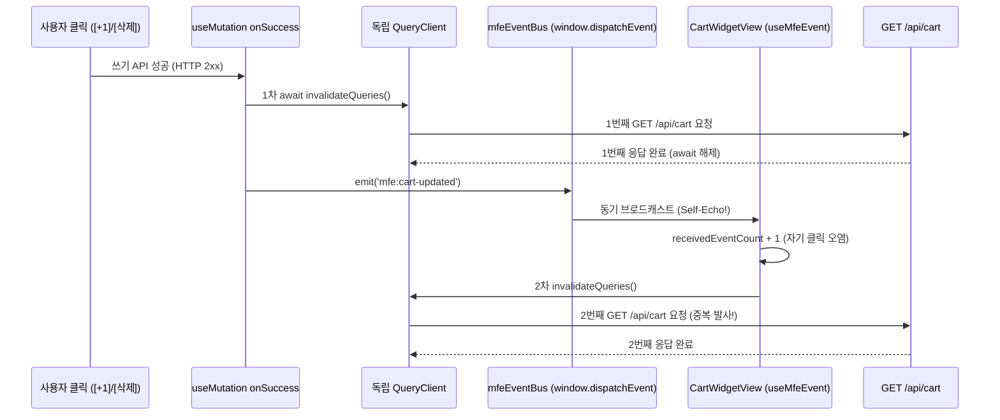
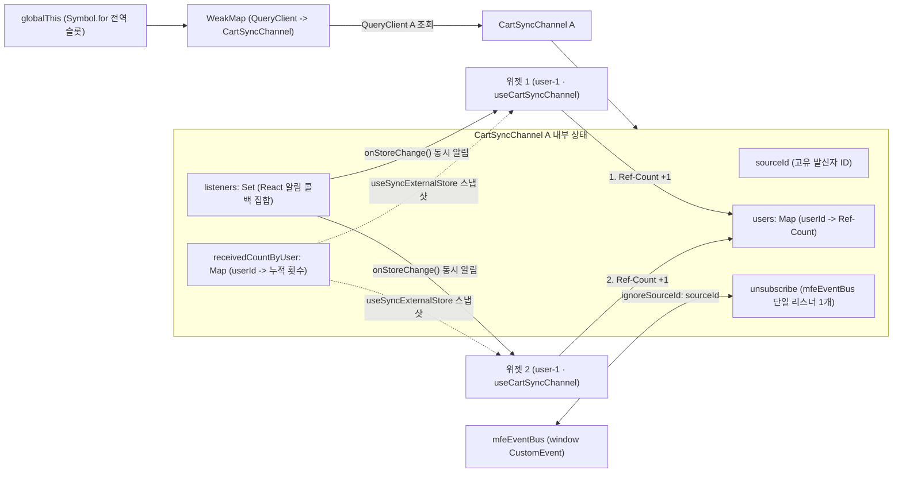
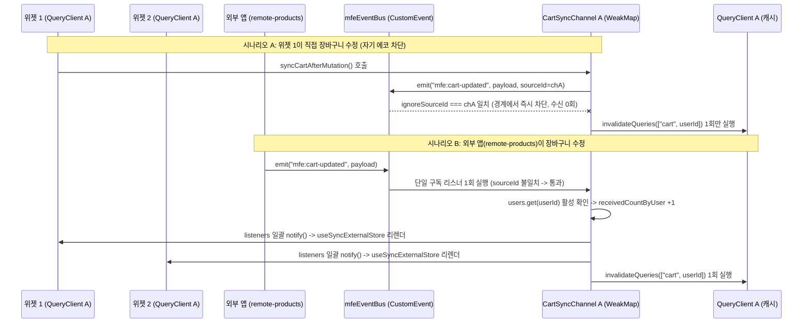
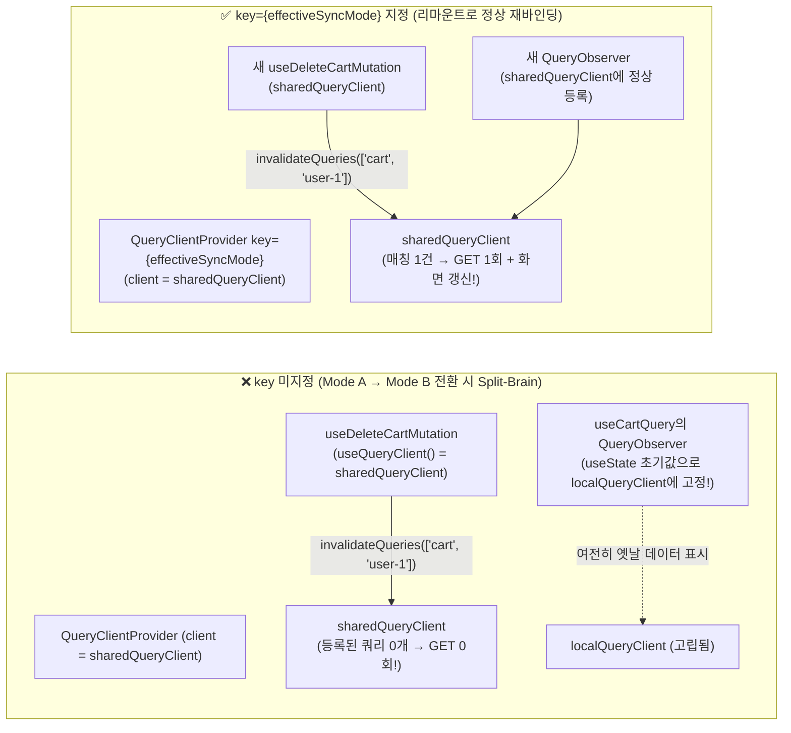

# Study 12. MFE `Mode A` 이벤트 자기 에코(Self-Echo) 차단(`sourceId` 표준 패턴)과 `QueryClient` 단위 상태 동기화 아키텍처

> **문서 목적**: `React 19 + TanStack Query v5 + Module Federation + Zod + window.CustomEvent` 기반의 `Mode A (mode-a-event)` 상태 동기화에서 발생하는 **자기 에코(Self-Echo) 중복 `invalidateQueries` 문제**를 분석하고, 현업 MFE 표준인 **`mfeEventBus` 발신자 식별(`sourceId` / `ignoreSourceId`) 패턴**과 **`QueryClient` 단위 단일 리스너 채널**을 결합한 최종 아키텍처를 정리한 영구 학습·구현 정본입니다.
>
> **현재 적용 상태 및 2단계 로드맵**:
> - **1차 (`Scope: shared` | `Branch: shared/feat/event-bus-source-id`, PR #16 완료)**: `remote-shared/utils`의 `mfeEventBus`·`useMfeEvent`에 선택적 `{ sourceId }` / `{ ignoreSourceId }` 자동 필터링, `MfeEventMeta`, `createMfeEventSourceId(prefix)` 추가 완료
> - **2차 (`Scope: cart` | `Branch: cart/refactor/queryclient-sync-channel`)**: `apps/remote-cart`에서 `QueryClient`별 고유 `sourceId` + 단일 리스너 채널 적용 및 8대 회귀 테스트 구축 *(1차 머지 직후 진행)*
> - **호스트 2종(`host-vite`, `host-rspack`) 및 향후 모든 MFE**: [`Study 04 #09`](./04-mfe-real-world-pitfalls-and-solutions.md) 트러블슈팅 체크리스트를 통해 동일한 `sourceId` 패턴을 1줄로 재사용
>
> **관련 문서**:
> - MFE `Mode A vs Mode B` 비교 학습 개념: [Study 01. MFE 개념 및 핵심 원리 가이드](./01-mfe-concepts-and-guide.md)
> - MFE 좀비 이벤트 리스너 및 자기 에코 트러블슈팅: [Study 04. MFE 14대 실전 고유 이슈와 해결 아키텍처 (`#09`)](./04-mfe-real-world-pitfalls-and-solutions.md)
> - 비동기 경쟁 상태(Race Condition) 및 `AbortSignal` 방어: [Study 05. 풀스택 서비스 구현 16대 실전 이슈](./05-fullstack-service-real-world-issues.md), [Study 08. AbortController · AbortSignal 패턴](./08-abort-signal-and-async-cancellation.md)

---

## 1. 문제 배경 및 발생 메커니즘 (Self-Echo + 중복 네트워크 호출)

### 1.1 MFE 동기화 비교 모드 전제
우리 프로젝트는 마이크로 앱 간 서버 상태 동기화 방식을 비교 학습하기 위해 두 모드를 대칭적으로 유지합니다.

| 모드 | 캐시(`QueryClient`) 소유 | 동기화 수단 | 이벤트 발행/구독 |
| :--- | :--- | :--- | :--- |
| **Mode A (`mode-a-event`)** | 리모트(위젯)별 독립 `QueryClient` | `window.CustomEvent` 기반 `mfeEventBus` | **발행 및 구독 수행** (약결합) |
| **Mode B (`mode-b-query`)** | 싱글톤 `sharedQueryClient` 공유 | `sharedQueryClient.invalidateQueries` | **발행·구독 모두 0회** |

`apps/remote-shared`의 이벤트 버스(`mfeEventBus`)는 다음 두 가지 특성을 가집니다.
1. **Zod 런타임 검증 및 `strip` 기본 동작**: `emit()`과 `subscribe()` 양쪽에서 `MFE_EVENT_SCHEMAS`로 `safeParse()`를 실행하며, `z.object()` 기본 동작(`strip`)에 따라 선언되지 않은 키는 결과 객체에서 자동 제거됩니다.
2. **동기(Synchronous) DOM 이벤트 디스패치**: 브라우저 DOM 표준상 `window.dispatchEvent(new CustomEvent(...))`는 태스크 큐에 넣지 않고 현재 콜스택에서 등록된 모든 리스너를 즉시 순차 실행합니다.

### 1.2 `GET /api/cart`가 2번 호출되는 원인 (`Step 1.4` 초기 구현)

`apps/remote-cart`처럼 **같은 이벤트를 발행하면서 동시에 구독하는 컴포넌트**(또는 향후 양방향 동기화를 수행하는 호스트 2종)에서는 아래 연쇄가 발생합니다.

```ts
// 1) 쓰기 뮤테이션 성공 시 (문제 시점 구현)
await queryClient.invalidateQueries({ queryKey: CART_QUERY_KEY }); // 1번째 GET /api/cart (완료까지 await)
if (syncMode === 'mode-a-event') {
  mfeEventBus.emit(MFE_EVENTS.CART_UPDATED, eventPayload);         // 직후 동기 이벤트 발행
}

// 2) 같은 앱 내부의 이벤트 구독 리스너 (문제 시점 구현)
useMfeEvent(MFE_EVENTS.CART_UPDATED, (payload) => {
  // 자기가 발행한 이벤트인데도 되받아서(Self-Echo) 외부 수신 카운터 오염 + 2번째 GET 발사!
  setReceivedEventCount((prev) => prev + 1);
  void activeQueryClient.invalidateQueries({ queryKey: CART_QUERY_KEY });
});
```



- **핵심 문제 2가지**:
  1. **불필요한 중복 네트워크 요청**: `await invalidateQueries`가 끝난 직후 `emit`이 호출되므로 TanStack Query의 요청 중복 제거(in-flight deduplication)마저 빗나가 **항상 실제 `GET /api/cart`가 2번 연달아 호출**됩니다.
  2. **관측 지표(`receivedEventCount`) 오염**: 외부 앱(`remote-products` 등)에서 온 신호만 세어야 하는 배지가 자기 버튼 클릭 때마다 증가합니다.

---

## 2. 현업·브라우저 표준 대안 비교 및 최종 채택 근거

### 2.1 현업 및 커뮤니티 주요 해법 5종 비교

| 대안 | 핵심 메커니즘 | 장점 | 한계 / 트레이드오프 |
| :--- | :--- | :--- | :--- |
| **대안 1. `mfeEventBus` 발신자 식별(`sourceId`) 예약 메타 키 + `QueryClient` 단위 단일 리스너 채널 *(최종 채택)*** | `emit(..., { sourceId })`로 `CustomEvent.detail`에 `__mfeSourceId` 메타 첨부, `subscribe(..., { ignoreSourceId })`가 Zod 파싱 전 1줄 차단(`if (sourceId === ignoreSourceId) return;`) | 1) **현업 MFE(ThoughtWorks, `mitt`/`RxJS` 래퍼) 압도적 표준**<br>2) **도메인 Zod 스키마 무변경 & 구버전·신버전 양방향 100% 하위 호환**(`Zod strip` 활용)<br>3) **`remote-cart` + 호스트 2종(`host-vite`/`host-rspack`) 모두 1줄로 공짜 재사용**<br>4) 동기(`CustomEvent`)·비동기(`BroadcastChannel`) 모두 동일 동작<br>5) `MfeInspector`가 `meta.sourceId`로 발신 출처까지 로그 추적 가능 | 최하위 공통 모듈 `remote-shared/utils`에 소규모 확장 PR 1건 선행 필요 *(본 프로젝트는 직접 관리하므로 제약 없음)* |
| **대안 2. 브라우저 네이티브 `BroadcastChannel` API** | `new BroadcastChannel('mfe-cart')`를 클라이언트별 생성 (`postMessage`는 MDN 스펙상 발신 인스턴스 자신에게 미전달) | Zero-Library 자기 에코 자동 차단 + 멀티 탭 동기화 공짜 | `CustomEvent` 기반 `Mode A` 학습 컨셉과 결이 다르고, 비동기 Task Queue 실행·`jsdom` 폴리필/디버깅 고려 필요 |
| **대안 3. `@tanstack/query-broadcast-client-experimental`** | `BroadcastChannel` + `let transaction = false` 락으로 타 `QueryClient`에 `query.setState()` 직접 복제 | 재조회 없이 캐시 직접 동기화 | `Mode A`(`CustomEvent` 재조회) vs `Mode B`(`sharedQueryClient`) 비교 학습 목적에 맞지 않음 |
| **대안 4. `remote-cart` 단독 `selfEchoTokens` 동기 스택 우회** | `remote-shared` 무수정 전제로, 동기 `dispatchEvent` 도중 페이로드 7개 필드를 스택 비교해 1회 소비 | 타 팀 소유 `remote-shared`를 절대 수정 못 할 때 단독 우회 가능 | 코드 복잡도 높음, 동기 디스패치 전제에 강하게 결합, 호스트 2종에서 재사용 불가 |
| **대안 5. `mitt` / `EventEmitter3` / `RxJS` 라이브러리 교체** | 서드파티 이벤트 버스 라이브러리 도입 | 유틸리티 API 풍부 | 자기 에코 차단 기능은 내장되어 있지 않아 결국 **대안 1(`sourceId` 필터링)**을 한 겹 감싸야 함 |

### 2.2 왜 `CustomEvent.detail`을 `{ payload, meta }`로 감싸지 않고 `__mfeSourceId` 예약 키를 쓰는가?
- 만약 `detail` 전체를 `{ payload, meta }`로 감싸면 구버전 리모트(`schema.safeParse(event.detail)`)나 `event.detail`을 직접 읽는 외부 코드가 즉시 파싱 실패합니다.
- 반면 평문 도메인 객체에 예약 메타 키 `__mfeSourceId`만 선택적으로 첨부하면 **4가지가 동시에 성립**합니다:
  1. **신버전 발신 → 신버전 수신**: `subscribe`가 `safeParse` **전**에 `__mfeSourceId`를 추출해 `ignoreSourceId` 일치 시 즉시 차단하고, 통과 시 `Zod` 기본 `strip`이 `__mfeSourceId`를 자동 제거해 핸들러에는 **순수 도메인 페이로드(`parsed.data`)** + 선택적 두 번째 인자 `meta?: { sourceId?: string }`로 전달합니다.
  2. **신버전 발신 → 구버전 수신**: 구버전 `z.object().safeParse()`가 알 수 없는 키 `__mfeSourceId`를 에러 없이 자동 제거(`strip`)해 정상 동작합니다.
  3. **구버전 발신(`remote-products` 등) → 신버전 수신**: `__mfeSourceId`가 없으므로 필터링에 걸리지 않고 `handler(parsed.data)` 1개 인자로 호출되어 기존 소비자·테스트(`toHaveBeenCalledWith(payload)`)가 단 1건도 깨지지 않습니다.
  4. **직렬화·비동기 확장 100% 호환**: 순수 문자열 키이므로 향후 `BroadcastChannel`이나 `postMessage`로 전송 계층을 교체해도 `sourceId`가 손실되지 않습니다.

---

## 3. 최종 채택 아키텍처 (4대 원칙 & 2계층 구현 레퍼런스)

### 3.1 핵심 아키텍처 4대 원칙
1. **발신자 식별(`sourceId`)의 공통화**: 모든 MFE 앱·위젯·호스트는 `remote_shared/utils`의 `createMfeEventSourceId(prefix)`로 고유 ID를 발급하고, `emit(..., { sourceId })` / `subscribe(..., { ignoreSourceId })` (또는 `useMfeEvent`)를 사용해 자기 에코를 이벤트 버스 경계에서 1줄로 차단합니다.
2. **동기화 소유 단위 = `QueryClient`**: 장바구니처럼 캐시(`QueryClient`)를 가진 도메인 앱은 `QueryClient` 인스턴스당 고유 `sourceId` 1개와 이벤트 리스너 최대 1개(`Ref-Counting`)를 부여합니다.
3. **`emit` 선행(`try/catch` 격리) → `await invalidateQueries` 1회**: 쓰기 API(`onSuccess`)는 이미 DB 커밋 완료 시점이므로, 타 `QueryClient`에 이벤트를 먼저 알리고(외부 리스너 예외 격리) 로컬 `QueryClient`는 `await invalidateQueries({ queryKey: [...CART_QUERY_KEY, userId] })`를 정확히 1회 수행합니다.
4. **`Mode A` / `Mode B` 완전 격리**: `Mode B`에서는 이벤트 구독(`enabled: false`)과 발행을 모두 `0회`로 유지합니다.

### 3.2 1차 구현 (`apps/remote-shared` — `event-bus.ts` 공개 계약)

```ts
// apps/remote-shared/src/features/utils/model/event-bus.ts (1차 PR 핵심 시그니처)
export interface MfeEventEmitOptions {
  /** 이벤트를 발행하는 앱·위젯·QueryClient 인스턴스의 고유 발신자 ID */
  sourceId?: string;
}

export interface MfeEventSubscribeOptions {
  /** 이 ID와 일치하는 sourceId로 발행된 자기 이벤트(Self-Echo)를 수신 단계에서 자동 무시합니다. */
  ignoreSourceId?: string;
}

export interface MfeEventMeta {
  /** 발신 측이 emit 옵션으로 전달한 고유 발신자 ID */
  sourceId?: string;
}

export function createMfeEventSourceId(prefix: string): string;
```

- **호스트 2종(`host-vite`, `host-rspack`) 재사용 예시 (단 2줄!)**:
  ```ts
  const hostSourceId = useMemo(() => createMfeEventSourceId('host-vite'), []);

  // 호스트가 이벤트를 발행할 때
  mfeEventBus.emit(MFE_EVENTS.AUTH_CHANGED, payload, { sourceId: hostSourceId });

  // 호스트가 같은 이벤트를 구독할 때 (자기 에코 자동 차단!)
  useMfeEvent(MFE_EVENTS.AUTH_CHANGED, handleExternalAuthChange, {
    ignoreSourceId: hostSourceId,
  });

  // 호스트 MfeInspector가 모든 앱의 이벤트를 출처까지 감시할 때 (ignoreSourceId 미지정)
  useMfeEvent(MFE_EVENTS.CART_UPDATED, (payload, meta) => {
    appendLog({ event: 'mfe:cart-updated', from: meta?.sourceId ?? 'unknown', payload });
  });
  ```

- **실전 보충 — `createMfeEventSourceId`와 트랜스파일링 vs 폴리필 vs 런타임 폴백 (`Web Crypto Secure Context` 함정)**:
  - `Vite(esbuild)`·`Rspack(SWC)`의 `build.target` 설정(`chrome89` 등)은 `?.`, `??`, `JSX` 같은 **JS 문법(Syntax)을 번역(트랜스파일링)**할 뿐, `crypto.randomUUID()` 같은 **브라우저 내장 Web API(폴리필 대상)**를 자동으로 채워 넣지 않습니다.
  - 특히 `crypto.randomUUID()`는 **Chrome 92+**부터 지원될 뿐만 아니라, Web Crypto API 보안 스펙상 **보안 컨텍스트(`https://` 또는 `http://localhost`)에서만 활성화**됩니다. 즉, 최신 Chrome 브라우저라도 사내 테스트 서버나 모바일 LAN 환경처럼 **`http://192.168.x.x:3000` 비보안 HTTP 주소로 접속하면 `crypto.randomUUID` 자체가 `undefined`로 사라져 `TypeError` 크래시**가 발생합니다.

  | 개념 | 대상 | 대표 예시 | `Vite`/`Rspack` 기본 `target` 설정으로 자동 해결되나? |
  | :--- | :--- | :--- | :---: |
  | **트랜스파일링 (Transpiling)** | 새로운 **JS 문법(Syntax)** 번역 | `?.`, `??`, `class`, `async/await`, `JSX` | ✅ **자동 번역됨** (`esbuild` / `SWC`) |
  | **폴리필 (Polyfill)** | 구형 브라우저에 없는 **내장 API·메서드** 구현체 주입 | `crypto.randomUUID()`, `Array.prototype.at()`, `structuredClone()` | ❌ **자동 주입 안 됨** (`core-js`, `@vitejs/plugin-legacy` 등 별도 설정 필요) |
  | **런타임 폴백 (Fallback)** | 구형 브라우저 + **최신 브라우저의 `http://IP` 비보안 컨텍스트(`Secure Context`) 제약** 방어 | `typeof globalThis.crypto?.randomUUID === 'function' ? ... : fallback` | 코드에서 직접 분기 처리 (가장 가볍고 안전) |

  - 이에 따라 `createMfeEventSourceId`는 `https://`/`localhost`에서는 표준 `crypto.randomUUID()`를 우선 사용하고, 미지원 환경(사내 `http://IP`, `Chrome 89~91`, 일부 테스트 런타임)에서는 단조 증가 시퀀스 + 타임스탬프 폴백(`fallback-<seq>-<ts>`)으로 안전하게 동작하도록 방어합니다.

### 3.3 2차 구현 (`apps/remote-cart` — `cart-sync-channel.ts` 실제 구현 레퍼런스)

1차 PR에서 `mfeEventBus`가 `sourceId` 필터링을 내장함에 따라, 2차 PR(`cart/refactor/queryclient-sync-channel`)의 [`cart-sync-channel.ts`](../../apps/remote-cart/src/features/cart/model/cart-sync-channel.ts)는 복잡한 `selfEchoTokens` 스택·페이로드 7개 필드 비교 없이 **QueryClient 단위 채널 레지스트리 + Ref-Counting + `useSyncExternalStore`** 구조로 단순화되었습니다.

#### 1) 모듈 공개 함수 및 핵심 흐름 요약

| 함수 / 훅 | 역할 | 핵심 방어 포인트 |
| :--- | :--- | :--- |
| **`buildCartUserQueryKey(userId)`** | `['cart', userId]` 튜플 생성 | 사용자 단위 prefix 무효화(`invalidateQueries`)·취소(`cancelQueries`) 타깃 |
| **`buildCartQueryKey(userId, options)`** | `['cart', userId, { apiBaseUrl, simulateDelay }]` 생성 | TanStack Query v5 `exact: false` 규약으로 사용자별·전체(`['cart']`) 무효화 모두 호환 |
| **`getCartSyncSourceId(queryClient)`** | 해당 `QueryClient` 전용 `sourceId` 반환 | 최초 1회 채널 생성 후 동일 `QueryClient` 내 모든 위젯이 공유 |
| **`getCartSyncReceivedCount(queryClient, userId)`** | 외부 이벤트 수신 누적 횟수 조회 | 비로그인(`null`) 또는 레지스트리 미등록 시 채널을 만들지 않고 즉시 `0` 반환 (읽기 전용 부수효과 방지) |
| **`subscribeCartSync(queryClient, userId)`** | `mfeEventBus` 단일 구독 등록 및 멱등 해제 | `users` Ref-Counting + `disposed` 멱등 가드 + `{ ignoreSourceId: channel.sourceId }` |
| **`useCartSyncChannel(queryClient, userId, enabled)`** | React 훅 (`useEffect` 구독 + `useSyncExternalStore`) | `Mode B` (`enabled === false`) 또는 비로그인 시 구독 `0회` 완전 격리 |
| **`syncCartAfterMutation(queryClient, syncMode, payload)`** | 쓰기 뮤테이션 성공 직후 동기화 실행 | `Mode A` 선 `emit`(`try/catch` 외부 리스너 예외 격리) → 후 로컬 `invalidateQueries` 1회 |

#### 2) 전체 동작 플로우 & 구조 다이어그램

- **구조 연결도: `WeakMap` 싱글톤 레지스트리와 다중 위젯 연결**



- **실행 플로우: 자기 에코 차단 vs 외부 이벤트 다중 위젯 동기화 (`Mode A`)**



#### 3) 핵심 구현 코드 (`apps/remote-cart/src/features/cart/model/cart-sync-channel.ts`)

```ts
export interface CartSyncChannel {
  /** 이 QueryClient 인스턴스 전용 고유 발신자 ID (자기 에코 자동 차단 키) */
  sourceId: string;
  /** 현재 이 QueryClient에서 구독 중인 userId별 활성 위젯 참조 수(Ref-Count) 맵 */
  users: Map<string, number>;
  /** 외부 이벤트 수신으로 실제 캐시 무효화가 발생한 userId별 누적 횟수 맵 */
  receivedCountByUser: Map<string, number>;
  /** QueryClient당 최대 1개만 유지되는 mfeEventBus.subscribe 해제 함수 */
  unsubscribe?: () => void;
  /** useSyncExternalStore 구독 컴포넌트에 스냅샷 변경을 알리는 리스너 집합 */
  listeners: Set<() => void>;
}

const REGISTRY_SYMBOL = Symbol.for('mfe-study.remote-cart.sync-channels');

// 1) subscribeCartSync(queryClient, userId): Ref-Counting + 단일 리스너 + 멱등 클린업
export function subscribeCartSync(queryClient: QueryClient, userId: string): () => void {
  const channel = getOrCreateChannel(queryClient);
  channel.users.set(userId, (channel.users.get(userId) ?? 0) + 1);

  if (!channel.unsubscribe) {
    channel.unsubscribe = mfeEventBus.subscribe(
      MFE_EVENTS.CART_UPDATED,
      (payload) => {
        const activeCount = channel.users.get(payload.userId) ?? 0;
        if (activeCount <= 0) return; // 현재 활성 구독 중인 userId만 통과(화이트리스트 방어)

        channel.receivedCountByUser.set(
          payload.userId,
          (channel.receivedCountByUser.get(payload.userId) ?? 0) + 1,
        );
        for (const notify of channel.listeners) notify(); // 동일 QueryClient 구독 위젯 일괄 알림

        void queryClient.invalidateQueries({
          queryKey: buildCartUserQueryKey(payload.userId),
        });
      },
      { ignoreSourceId: channel.sourceId }, // 👈 단 1줄로 자기 에코 완전 차단!
    );
  }

  let disposed = false; // StrictMode·수동 중복 호출 방지 멱등 가드
  return () => {
    if (disposed) return;
    disposed = true;

    const remaining = (channel.users.get(userId) ?? 0) - 1;
    if (remaining <= 0) channel.users.delete(userId);
    else channel.users.set(userId, remaining);

    if (channel.users.size === 0 && channel.unsubscribe) {
      const unsubscribe = channel.unsubscribe;
      channel.unsubscribe = undefined;
      unsubscribe();
    }
  };
}

// 2) useCartSyncChannel(queryClient, userId, enabled): 구독 + 외부 스토어 스냅샷 동기화
export function useCartSyncChannel(
  queryClient: QueryClient,
  userId: string | null,
  enabled: boolean,
): number {
  useEffect(() => {
    if (!enabled || !userId) return; // Mode B(enabled=false)에서는 EventBus 리스너 0개 보장
    return subscribeCartSync(queryClient, userId);
  }, [queryClient, userId, enabled]);

  const subscribe = useCallback(
    (onStoreChange: () => void) => {
      if (!enabled || !userId) return () => {}; // Mode B·비로그인 시 내부 Store 구독·빈 채널 생성도 0회 격리
      return subscribeChannelStore(queryClient, onStoreChange);
    },
    [queryClient, userId, enabled],
  );

  return useSyncExternalStore(
    subscribe,
    () => (enabled ? getCartSyncReceivedCount(queryClient, userId) : 0),
    () => 0, // SSR 및 hydration용 스냅샷
  );
}

// 3) syncCartAfterMutation(queryClient, syncMode, eventPayload): 선 emit(격리) → 후 무효화 1회
export async function syncCartAfterMutation(
  queryClient: QueryClient,
  syncMode: SyncMode,
  eventPayload: CartUpdatedEventPayload,
): Promise<void> {
  if (syncMode === 'mode-a-event') {
    const channel = getOrCreateChannel(queryClient);
    try {
      mfeEventBus.emit(MFE_EVENTS.CART_UPDATED, eventPayload, {
        sourceId: channel.sourceId,
      });
    } catch (error) {
      console.error('[remote-cart] mfe:cart-updated 이벤트 발행 중 외부 리스너 오류:', error);
    }
  }

  await queryClient.invalidateQueries({
    queryKey: buildCartUserQueryKey(eventPayload.userId),
  });
}
```

- **실전 보충 1 — `WeakMap` + `globalThis` + `Symbol.for()` 싱글톤 채널 레지스트리와 타입 단언**:
  `cart-sync-channel.ts`의 `getChannelRegistry()`는 MFE 이중 번들링·HMR 환경에서도 깨지지 않는 **`QueryClient` 단위 싱글톤 레지스트리**를 구현하기 위해 아래 4가지 장치를 결합합니다.

  ```ts
  const REGISTRY_SYMBOL = Symbol.for('mfe-study.remote-cart.sync-channels');

  function getChannelRegistry(): WeakMap<QueryClient, CartSyncChannel> {
    const globalStore = globalThis as Record<
      symbol,
      WeakMap<QueryClient, CartSyncChannel> | undefined
    >;
    let registry = globalStore[REGISTRY_SYMBOL];

    if (!registry) {
      registry = new WeakMap<QueryClient, CartSyncChannel>();
      globalStore[REGISTRY_SYMBOL] = registry;
    }

    return registry;
  }
  ```

  1. **`WeakMap` (메모리 누수 자동 방지)**:
     | 구분 | 일반 `Map` | `WeakMap` |
     | :--- | :--- | :--- |
     | **키(Key) 제한** | 원시값·객체 모두 가능 | **객체(또는 심볼)만 가능** (여기선 `QueryClient` 인스턴스) |
     | **참조 방식 & GC** | 키를 강하게 참조해 수동 `delete` 없이는 메모리 누수 발생 | **약한 참조(Weak Reference)** — `QueryClient`가 언마운트되어 GC될 때 연결된 `CartSyncChannel`도 **자동 회수** |
     | **목록 순회** | `keys()`, `entries()` 순회 가능 | **순회 불가** (정확한 `QueryClient` 참조 없이는 내부 조회 불가) |

  2. **`globalThis` (번들·HMR 분할 방어)**:
     - 브라우저(`window`)와 Node.js/Vitest(`global`)를 아우르는 JS 표준 전역 객체입니다.
     - 파일 최상단에 일반 변수(`const registry = new WeakMap()`)로 두면 Module Federation 청크가 중복 평가되거나 Vite/Rspack HMR이 발생할 때마다 새 `WeakMap`이 생성되어 `sourceId`와 채널 상태가 쪼개집니다. `globalThis`에 올려두면 모듈이 몇 번 재평가되어도 **앱 전체에서 단 하나의 레지스트리**를 유지합니다.

  3. **`Symbol`과 `Symbol.for()` (이름 충돌 없는 싱글톤 열쇠)**:
     - **`Symbol` 사용 이유**: `globalThis`는 모든 스크립트가 공유하는 공간이므로 문자열 키(`globalThis['cartChannels']`)를 쓰면 타 코드와 이름이 겹쳐 덮어써질 위험이 있습니다. `Symbol` 키는 절대 충돌하지 않으며 `Object.keys(globalThis)` 같은 일반 순회에도 노출되지 않는 은닉 슬롯 역할을 합니다.
     - **`Symbol()` vs `Symbol.for()` 차이**:
       ```ts
       Symbol('key') === Symbol('key')         // false — 호출마다 매번 완전히 새로운 심볼 생성 (HMR 시 기존 저장소 분실)
       Symbol.for('key') === Symbol.for('key') // true  — 전역 심볼 저장소(Global Symbol Registry)에서 동일 이름의 심볼 재사용
       ```
       따라서 `Symbol.for('mfe-study.remote-cart.sync-channels')`로 어디서든 동일한 열쇠를 확보하고, `globalThis[REGISTRY_SYMBOL]`로 `WeakMap`을 1회만 생성·공유하는 **MFE/HMR 안전 싱글톤 패턴**이 완성됩니다.

  4. **`globalThis as Record<symbol, ...>` 타입 단언 이유**:
     - TypeScript의 기본 `globalThis` 타입 정의에는 커스텀 `REGISTRY_SYMBOL` 슬롯이 선언되어 있지 않아 바로 인덱싱하면 컴파일 오류가 발생합니다.
     - 런타임 객체를 변경하는 것이 아니라 컴파일러에게 *"이 전역 객체를 `symbol → WeakMap<QueryClient, CartSyncChannel> | undefined` 사물함으로 본다"*는 타입 뷰(View)를 강제 지정함으로써, `if (!registry)` 분기 이후 안전하게 `WeakMap` 타입으로 좁히기(Type Narrowing)하기 위한 장치입니다.

  5. **실전 한계 및 GC 주의점**:
     - **HMR 단독 핫스왑 한계**: `globalThis + Symbol.for`로 레지스트리를 보존하더라도, `cart-sync-channel.ts` 파일만 단독 HMR로 교체되면 기존 `channel.unsubscribe`에 등록된 이벤트 리스너 클로저는 이전 모듈 구현을 계속 참조할 수 있습니다(React Fast Refresh로 컴포넌트가 리마운트되어 `users.size === 0`이 되면 해제 후 재등록됨). 즉, 이 패턴은 완벽한 HMR 핫스왑 보장이 아니라 **모듈 재평가 시 레지스트리 분할 방지**가 목적입니다.
     - **`WeakMap`이 `unsubscribe`를 대체하지 않음**: `window.addEventListener`에 등록된 이벤트 리스너가 클로저로 `queryClient`를 붙잡고 있으면 리스너 해제 전까지 `QueryClient`가 GC 대상이 되지 않습니다. 따라서 `WeakMap`은 **명시적 `unsubscribe()` 완료 후 남은 채널 메타데이터(`sourceId`, `receivedCountByUser`)를 자동 회수**하는 용도이며, cleanup 해제는 반드시 유지해야 합니다.

- **실전 보충 2 — `users: Map<string, number>`의 두 가지 역할과 일반 실무 앱과의 차이**:
  `users` 맵은 **[키: `userId`]**와 **[값: `Ref-Count(number)`]**가 서로 다른 책임을 가집니다.
  1. **키(`string` = `userId`)가 필요한 이유 (MFE 멀티 유저 · 유저 전환 필터링)**:
     - 일반 실무 서비스는 브라우저 세션당 1명의 사용자만 로그인하고 로그아웃 시 `queryClient.clear()`로 전체 캐시를 초기화하므로 `userId`별 맵 분리가 필요 없을 수 있습니다.
     - 반면 본 MFE 학습 앱은 한 화면에 `user-1`·`user-2` 위젯을 동시에 배치하거나 드롭다운으로 유저를 즉석 전환하므로, 현재 `QueryClient`에서 실제로 마운트되어 구독 중인 `userId`만 선별해 무효화하기 위해 키로 구분합니다.
  2. **값(`number` = Ref-Counting)이 필요한 이유 (로그아웃 유무와 무관한 필수 장치)**:
     - 일반 실무 앱이라도 **같은 `QueryClient`를 공유하는 위젯이 화면에 2개 이상 동시에 뜰 수 있는 한**(예: 상단 헤더 장바구니 배지 + 사이드바 위젯) 참조 카운트는 필수입니다.
     - 1개 위젯만 닫혀 언마운트되었을 때 무조건 `unsubscribe()` 하면 살아있는 다른 위젯까지 동기화가 끊어지므로, `remaining <= 0`이 되어 **마지막 위젯 1개까지 언마운트될 때만** `mfeEventBus` 구독을 해제합니다. (`disposed` 가드는 React 19 `<StrictMode>` 이중 클린업에서 카운트가 두 번 차감되는 것을 막습니다.)

- **실전 보충 3 — `receivedCountByUser` 생명주기 정책과 보안·세션 격리 포인트**:
  1. **현재 채택된 카운터 생명주기 정책 (`QueryClient` 수명 기준 누적)**:
     | 정책 후보 | 동작 방식 | 본 프로젝트 채택 여부 |
     | :--- | :--- | :---: |
     | **활성 위젯 세션 기준** | 마지막 위젯 언마운트(`remaining <= 0`) 시 `receivedCountByUser.delete(userId)` 초기화 | 미채택 (실무 공용 PC·세션 흔적 정리 필요 시 선택) |
     | **`QueryClient` 생명주기 기준** | `QueryClient`가 살아있는 동안 사용자별 누적 횟수 유지 (`TC-04` 단위 테스트로 명시 검증) | ✅ **현재 채택** (Mode 전환·유저 전환 비교 학습 누적 관측) |
     | **사용자 로그인 세션 기준** | 로그아웃·인증 세션 변경 시 초기화 | 미채택 (로그아웃 시 `queryClient.clear()`와 함께 적용 가능) |
  2. **타 사용자 이벤트 오염 차단 (`activeCount <= 0` 화이트리스트 가드)**:
     - 수신 리스너가 `channel.users.get(payload.userId) ?? 0`을 먼저 검사해 현재 활성 구독 중인 사용자가 아니면 카운터 증가와 `invalidateQueries`를 즉시 차단합니다.
  3. **브라우저 전역 노출 및 DevTools 디버깅 범위**:
     - Chrome DevTools에서 `globalThis`의 심볼 슬롯과 `WeakMap` 엔트리를 직접 펼치거나 디버거 중단점을 걸면 `userId`를 볼 수는 있습니다. 그러나 웹 브라우저 환경에서는 어차피 Network 탭(`GET /api/cart?userId=...`), React DevTools, Query 캐시에도 동일 ID가 노출되므로 별도 취약점이 되지 않습니다.
     - `Symbol.for`와 `sourceId`는 **이름 충돌 방지 및 중복 이벤트 필터링 용도이지 인증·보안 경계가 아닙니다.** 브라우저 메모리/키에는 이메일·전화번호 같은 개인정보(PII) 대신 **비식별 내부 ID(`user-1`, UUID)**만 사용하는 것이 원칙입니다.

- **실전 보충 4 — `useSyncExternalStore` 완벽 이해 (기초 원리 · 실무 사례 · 우리 코드 적용)**:
  React 18+ 공식 훅인 `useSyncExternalStore`는 **React(`useState`/`Context`) 바깥에 존재하는 저장소의 값을 React 컴포넌트가 안전하게 구독하고 화면을 다시 그리게 해주는 연결 다리**입니다.

  1. **STEP 1. 3대 파라미터와 역할 (셋터 ❌, 구독·조회 ⭕)**:
     ```ts
     const value = useSyncExternalStore(subscribe, getSnapshot, getServerSnapshot);
     ```
     | 파라미터 | 비유 (Redux/Zustand) | 역할 |
     | :--- | :--- | :--- |
     | **`subscribe(listener)`** | `store.subscribe` | **구독 등록 + 해제 함수 반환** 담당 (마운트 시 `listener` 등록, 언마운트 시 제거) |
     | **`getSnapshot()`** | `store.getState` / `selector` | **현재 값 조회(게터)** 담당 (값이 바뀌지 않았으면 동일 값/참조를 반환해야 무한 렌더 방지) |
     | **`getServerSnapshot()`** | SSR 초기 스냅샷 | 서버 렌더링 및 hydration 단계에서 사용할 기본값 반환 |
     - ※ `useSyncExternalStore` 자체에는 값을 바꾸는(셋터) 기능이 없습니다. 값 변경과 `notify()` 호출은 React 바깥 저장소의 일반 함수가 담당합니다.

  2. **STEP 2. `listener`에 실제로 주입되는 것과 `Set`으로 모으는 이유**:
     - 우리가 `subscribe(...)`를 직접 호출하지 않아도, **React가 내부적으로 `handleStoreChange`(스냅샷 비교 + 리렌더링 스위치) 함수를 만들어 `listener` 인자로 꽂아줍니다.**
       ```ts
       // 💡 React 내부(useSyncExternalStore) 동작을 이해하기 쉽게 풀어쓴 개념 코드
       function useSyncExternalStore(subscribe, getSnapshot) {
         const value = getSnapshot();
         const [, forceRender] = useState({});

         useEffect(() => {
           function handleStoreChange() {
             // getSnapshot()을 다시 실행해 이전 값과 Object.is 비교 후 달라졌을 때만 리렌더링!
             if (값이_달라졌으면(getSnapshot)) forceRender({});
           }
           // React가 우리가 넘긴 subscribe(handleStoreChange)를 대신 호출해 줌
           const unsubscribe = subscribe(handleStoreChange);
           return unsubscribe;
         }, [subscribe]);

         return value;
       }
       ```
     - **저장소가 `listener`로 할 수 있는 일**: 외부 저장소는 React 내부 구현을 알 수 없으며, 오직 **① 명단(`Set`)에 보관·제거**하고 **② 값이 바뀔 때 `listener()`를 호출**해 주는 것만 수행합니다(제어의 역전).
     - **단일 변수가 아닌 `Set`/배열로 모으는 이유**: 화면의 여러 컴포넌트가 동시에 구독할 때 덮어쓰기를 방지하고 모두에게 동시에 알리기 위함입니다. 또한 `Set.size === 0`일 때만 진짜 외부 리스너(`window` / `mfeEventBus`)를 1개 켜고, 명단이 `0`명이 될 때만 해제하면 컴포넌트를 100개 띄워도 외부 리스너는 1개만 유지됩니다.

  3. **STEP 3. `Provider + useEffect + useState/Context`와 비교 — 언제 쓰고 언제 피하나?**:
     | 비교 항목 | `Provider + useEffect([]) + useState/Context` | `useSyncExternalStore` |
     | :--- | :--- | :--- |
     | **`<Provider>` 필요 여부** | 앱 최상단 래핑 필수 *(MFE 단독 실행 시 누락 위험)* | **Provider 불필요** (필요한 컴포넌트에서 훅만 호출) |
     | **초기 렌더 타이밍** | 기본값 렌더 후 `useEffect`에서 한 박자 늦게 재렌더 | **첫 렌더부터 `getSnapshot()`으로 즉시 최신 값 반영** |
     | **리스너 수명** | 미사용 페이지에서도 Provider가 리스너 상시 유지 | 사용하는 컴포넌트가 마운트될 때만 구독, 0개 시 자동 해제 |
     - **무조건 `useSyncExternalStore`만 쓰면 안 되는 4가지 이유**:
       1. 단순 모달·폼 입력 등은 `useState` 1줄이면 끝날 일을 `Set`/`subscribe`/`getSnapshot` 보일러플레이트로 키우게 됩니다.
       2. 컴포넌트 인스턴스별 독립 지역 상태를 전역 저장소로 관리하면 서로 상태가 섞이기 쉽습니다.
       3. 이름 그대로 **동기(Sync)** 방식이라 무거운 `useTransition` 백그라운드 렌더링 최적화를 중단시킵니다.
       4. `getSnapshot()`이 매번 새 객체/배열을 반환하면 즉시 무한 리렌더링이 발생합니다.
     - **실무 선택 기준**: 평소 90% UI 상태(테마·모달·폼)는 `useState`/`useContext`를 쓰고, 나머지 10% **"주인이 React 바깥에 있는 상태"**에만 `useSyncExternalStore`를 사용합니다.

  4. **STEP 4. 실용적인 실무 사용 사례**:
     - **사례 1 — 브라우저 내장 API (`useOnlineStatus`, `useIsScrolled`)**:
       ```ts
       // 스크롤 위치 기반 헤더 축소/플로팅 TOP 버튼 등에서 단일 리스너 공유 + boolean 스냅샷 패턴
       const scrollListeners = new Set<() => void>();
       function handleScroll() {
         for (const notify of scrollListeners) notify();
       }
       function subscribeScroll(listener: () => void) {
         if (scrollListeners.size === 0) {
           window.addEventListener('scroll', handleScroll, { passive: true });
         }
         scrollListeners.add(listener);
         return () => {
           scrollListeners.delete(listener);
           if (scrollListeners.size === 0) window.removeEventListener('scroll', handleScroll);
         };
       }

       export function useIsScrolled(threshold = 50): boolean {
         return useSyncExternalStore(
           subscribeScroll,
           () => window.scrollY > threshold, // 👈 픽셀 숫자 대신 boolean만 반환해 50px 경계에서만 딱 1회 리렌더!
           () => false,
         );
       }
       ```
       - **팁**: 헤더 내부 자식(로고·검색창·메뉴)이 많을 때는 `Header` 부모 1곳에서만 `useIsScrolled()`를 호출해 `className="header--compact"`를 붙이고 CSS로 제어하는 것이 가장 빠르며, 헤더와 DOM이 떨어진 `FloatingTopButton` 등에서는 `Context` 없이 훅을 직접 호출하면 됩니다.
     - **사례 2 — React 바깥 모듈**: `ky`/`axios` HTTP 인터셉터의 `401` 세션 만료 상태 전파, WebSocket 연결 상태, 지도/차트 서드파티 SDK 상태 연동.
     - **사례 3 — MFE 및 상태 라이브러리 내부**: `@tanstack/react-query`(`useMutation.js`), Zustand, Redux 내부와 본 프로젝트의 `cart-sync-channel.ts`.

  5. **STEP 5. 우리 프로젝트(`cart-sync-channel.ts`) 적용 요약**:
     - `receivedCountByUser`는 React 외부(`WeakMap`)에 저장되며, 동일 `QueryClient`와 `userId`를 공유하는 위젯 A·B가 있을 때 외부 이벤트 수신 시 `channel.listeners`의 모든 `onStoreChange` 콜백을 호출해 두 위젯의 화면 배지 숫자를 100% 일치시킵니다.
     - 또한 `Mode B` (`enabled === false`) 또는 비로그인 상태에서는 `useEffect`뿐만 아니라 `useSyncExternalStore`의 `subscribe` 콜백에서도 즉시 빈 해제 함수(`() => {}`)를 반환해, `sharedQueryClient`에 불필요한 빈 `CartSyncChannel` 생성과 내부 `listeners` 등록까지 **진짜 `0회`**로 완전 격리합니다.

- **실전 보충 5 — `useCartSyncChannel` 가독성 해부: 두 가지 구독 체계 · 콜백 호출 주체 · 학습용 풀어쓰기**:
  인프라 계층 훅인 `useCartSyncChannel`이 처음 읽을 때 어렵게 느껴지는 이유는 **① 서로 다른 목적의 구독 체계 2개**가 공존하고, **② 내가 직접 호출하는 함수와 React·EventBus가 나중에 호출하는 콜백(제어의 역전, IoC)**이 섞여 있기 때문입니다.

  1. **두 가지 구독 체계 분리해서 이해하기**:
     - **구독 체계 A — 외부 이벤트 구독 (데이터 동기화 목적)**:
       ```text
       useEffect -> subscribeCartSync -> mfeEventBus.subscribe -> window.addEventListener
       ```
       역할: 외부 앱의 `mfe:cart-updated` 이벤트를 수신해 `QueryClient` 캐시를 무효화합니다.
     - **구독 체계 B — React 외부 스토어 구독 (UI 카운터 표시 목적)**:
       ```text
       useSyncExternalStore -> subscribe -> subscribeChannelStore -> channel.listeners
       ```
       역할: React 바깥(`WeakMap`)의 `receivedCountByUser`가 증가할 때 React 컴포넌트 리렌더링을 트리거합니다.

  2. **콜백 함수 9종의 호출 주체와 실행 시점**:
     | 함수 / 콜백 | 호출 주체 | 실행 시점 |
     | :--- | :--- | :--- |
     | `useEffect` 내부 콜백 | React | 컴포넌트 마운트 / 의존성 변경 시 (Effect setup) |
     | `subscribeCartSync` | `useEffect` 콜백 | Effect setup 시 **즉시 실행** (구독 등록 + 해제 함수 반환) |
     | `subscribeCartSync` 반환 함수 | React | 언마운트 / 의존성 변경 직전 (Effect cleanup) |
     | `mfeEventBus` 이벤트 핸들러 | EventBus (`window`) | `mfe:cart-updated` 외부 이벤트 수신 시 |
     | `useCallback`의 `subscribe` | React (`useSyncExternalStore`) | 외부 Store 구독 시작 시 |
     | `subscribeChannelStore` | `subscribe` 콜백 | Store 리스너 등록 시 |
     | `onStoreChange` (`notify`) | `CartSyncChannel` | 외부 이벤트 수신으로 카운터가 +1 증가할 때 |
     | `getSnapshot` | React (`useSyncExternalStore`) | 최초 렌더 및 `onStoreChange()` 통지 직후 최신 값 확인 시 |
     | `subscribeChannelStore` 반환 함수 | React (`useSyncExternalStore`) | 컴포넌트 언마운트 / `subscribe` 재생성 시 Store 구독 해제 |

  3. **학습용 명시적 풀어쓰기 버전 (실제 동작 100% 동일)**:
     축약 표현(`return subscribeCartSync(...)`)이 *"언마운트 때 등록되는 것 아닌가?"* 하고 헷갈릴 때는 아래처럼 중간 변수명을 붙여 풀어서 읽으면 실행 시점이 명확해집니다.
     ```ts
     // [학습용 명시적 풀어쓰기 버전 — 실제 소스(cart-sync-channel.ts)와 런타임 동작 100% 동일]
     export function useCartSyncChannel(
       queryClient: QueryClient,
       userId: string | null,
       enabled: boolean,
     ): number {
       useEffect(() => {
         if (!enabled || !userId) {
           return;
         }

         // 1) 마운트 시점에 즉시 실행되어 EventBus 구독을 등록하고, 해제 리모컨을 받아둠
         const unsubscribeCartSync = subscribeCartSync(queryClient, userId);

         // 2) React에 해제 리모컨만 반환 -> 언마운트 시점에 이 함수만 실행됨
         return unsubscribeCartSync;
       }, [queryClient, userId, enabled]);

       const subscribe = useCallback(
         (onStoreChange: () => void) => {
           if (!enabled || !userId) {
             return () => {};
           }

           const unsubscribeStore = subscribeChannelStore(queryClient, onStoreChange);
           return unsubscribeStore;
         },
         [queryClient, userId, enabled],
       );

       const getSnapshot = () => {
         if (!enabled) {
           return 0;
         }
         return getCartSyncReceivedCount(queryClient, userId);
       };

       const getServerSnapshot = () => {
         return 0; // SSR 및 hydration용 스냅샷
       };

       const receivedCount = useSyncExternalStore(
         subscribe,
         getSnapshot,
         getServerSnapshot,
       );

       return receivedCount;
     }
     ```
     - **가독성 판단 기준**: 단순한 1줄 계산은 축약 표현을 유지하되, **등록 시점과 호출 시점이 다른 클린업 함수 반환이나 다중 계층 콜백**은 팀 협업 시 위처럼 변수명을 부여해 추적 가능성을 높이는 것이 좋습니다.

- **실전 보충 6 — 라이브러리 소스(`@tanstack/react-query@5.105.1` · `react@19.3.1`) 기준 검증된 실전 한계 노트**:
  1. **모드 전환 중 진행 중인(in-flight) `Mutation` 콜백 동작**:
     - `@tanstack/react-query@5.105.1`(`useMutation.js`) 및 `@tanstack/query-core@5.105.1`(`mutationObserver.js`) 소스상, `<QueryClientProvider key={effectiveSyncMode}>`로 컴포넌트가 언마운트되어도 **이미 출발한 HTTP 뮤테이션 자체는 취소되지 않으며**, `mutate(vars, { onError, onSettled })` 같은 per-call 콜백만 해제되고 **`useMutation({ onSuccess })` 훅 레벨 콜백은 끝까지 실행**됩니다.
     - 따라서 쓰기 요청 응답이 돌아오기 전 0.1~0.3초 찰나에 드롭다운으로 `Mode A ↔ Mode B`를 전환하는 극단적 엣지 케이스에서는, 직전 모드의 `onSuccess`가 이전 `QueryClient`만 무효화하고 새 모드의 캐시는 `staleTime(10초)` 동안 갱신되지 않을 수 있습니다. 본 프로젝트는 Mode A/B 격리 학습 원칙을 지키기 위해 인위적 교차 무효화를 넣지 않고 이 한계를 명시해 둡니다.
  2. **언마운트 기간 중 외부 이벤트 누락과 `staleTime: 10_000` 트레이드오프**:
     - `window.CustomEvent`는 과거 이벤트를 보관·재전송하지 않으므로, 위젯이 언마운트된 기간(`Mode A → Mode B → 10초 내 Mode A 복귀` 등)에 발생한 외부 변경은 구독 해제 상태라 놓칠 수 있습니다.
     - `createMfeQueryClient()`의 기본값 `staleTime: 10_000`과 TanStack Query v5의 `refetchOnMount: true`(*stale일 때만 재조회*) 조합에서는, 10초 이내 재마운트 시 기존 `localQueryClient`의 `fresh` 캐시가 그대로 노출될 수 있습니다. 실무에서 `Mode A` 언마운트 공백 정합성이 최우선이라면 `refetchOnMount: 'always'`를 고려할 수 있으나, 본 프로젝트에서는 `Mode B` 캐시 히트 비교 학습을 위해 기본 정책을 유지합니다.

### 3.4 쿼리 키 구조 정렬 및 공식 스펙 근거 (`TanStack Query v5` · `React 19`)
1. **쿼리 키 정렬**: `['cart', { userId, apiBaseUrl, simulateDelay }]` → **`['cart', userId, { apiBaseUrl, simulateDelay }]`**
   - `TanStack Query v5`의 `invalidateQueries({ queryKey: ['cart', userId] })`와 `cancelQueries({ queryKey: ['cart', userId] })`는 기본값 `exact: false`(prefix 매칭)로 동작하므로 해당 사용자의 옵션 조합을 모두 갱신하면서 타 사용자 캐시는 격리합니다.
   - `Mode B`에서 `remote-products`가 호출하는 `sharedQueryClient.invalidateQueries({ queryKey: ['cart'] })`와도 100% 하위 호환됩니다.
2. **React 19 `<StrictMode>` & `useSyncExternalStore`**:
   - Ref-Counting(`users: Map<string, number>`) + 멱등 클린업(`let disposed = false`)으로 `<StrictMode>` 이중 마운트에도 좀비 리스너가 `0개`이며, `useSyncExternalStore`로 동일 `QueryClient` + 동일 `userId` 위젯 간 `receivedEventCount`가 100% 일치합니다.

### 3.5 실전 함정 — `Mode A ↔ Mode B` 전환 시 `<QueryClientProvider>`의 `QueryClient` 교체와 `QueryObserver` Split-Brain (`key` 리마운트 해결)

실제 브라우저에서 `Mode A (localQueryClient)`로 초기 마운트한 뒤 드롭다운으로 `Mode B (sharedQueryClient)`로 전환하고 `[장바구니 비우기]`나 `[+1]`을 클릭했을 때, **백엔드 `DELETE /api/cart/all`은 `200 OK`로 성공했는데도 직후 `GET /api/cart`가 호출되지 않고 이전 상품이 화면에 그대로 남는 장애**가 발생합니다.

#### 1) 원인: `TanStack Query v5` 내부 `Observer`의 `useState` 영구 바인딩
`@tanstack/react-query` v5의 `useBaseQuery.js`와 `useMutation.js` 내부 구현을 보면 다음과 같습니다.

```js
// @tanstack/react-query/build/modern/useBaseQuery.js
const client = useQueryClient(queryClient);
const [observer] = React.useState(() => new Observer(client, defaultedOptions));

// @tanstack/react-query/build/modern/useMutation.js
const client = useQueryClient(queryClient);
const [observer] = React.useState(() => new MutationObserver(client, options));
```

- **`QueryClient`** = API 캐시를 보관하는 **캐시 창고** (`Mode A`의 `localQueryClient` = 개인 창고, `Mode B`의 `sharedQueryClient` = 공용 창고).
- **`QueryObserver`** = `useQuery`가 내부적으로 고용해 특정 `QueryClient`의 쿼리 키 변화를 감시하는 **창고 감시원**.
- `React.useState(() => ...)`는 **컴포넌트가 처음 마운트될 때 딱 1번만 실행**되므로, 부모가 `<QueryClientProvider client={activeQueryClient}>`의 `client` prop만 `localQueryClient → sharedQueryClient`로 교체하고 하위 컴포넌트를 그대로 유지하면 **Split-Brain(창고 불일치)**이 발생합니다:
  1. **`useCartQuery`의 `QueryObserver`**: 최초 마운트 때 잡힌 **옛날 `localQueryClient`**에만 영구 고정되어 있음 (`sharedQueryClient`에는 `['cart', 'user-1']` 키가 **등록조차 안 됨**).
  2. **뮤테이션 훅 내부의 `useQueryClient()`**: 매 렌더링마다 최신 Context를 읽으므로 **새 `sharedQueryClient`**를 반환함.
  3. **`[장바구니 비우기]` 실행**: `DELETE 200 OK` 성공 후 `sharedQueryClient.invalidateQueries({ queryKey: ['cart', 'user-1'] })`를 호출하지만, `sharedQueryClient`에는 구독 중인 감시원이 `0명`이므로 **`GET /api/cart` 호출 `0회`**, 화면은 `localQueryClient`의 옛날 데이터를 그대로 유지.



#### 2) 해결책: `<QueryClientProvider key={effectiveSyncMode} client={activeQueryClient}>`
React에서 단일 컴포넌트에 `key`를 부여하는 것은 **"상태와 인스턴스를 완전히 새로 교체(Reset)"**하기 위한 공식 패턴입니다.

```tsx
// apps/remote-cart/src/exposed/CartWidget.tsx
return (
  <QueryClientProvider key={effectiveSyncMode} client={activeQueryClient}>
    <CartWidgetView
      userId={effectiveUserId}
      hostType={hostType}
      syncMode={effectiveSyncMode}
      simulateDelay={simulateDelay}
      delayMs={delayMs}
      apiBaseUrl={apiBaseUrl}
    />
  </QueryClientProvider>
);
```

- `effectiveSyncMode`가 `'mode-a-event'` ↔ `'mode-b-query'`로 바뀌면 React가 기존 트리를 **완전히 언마운트(옛날 `QueryObserver` 구독 해제 및 임시 UI 상태 초기화)**하고, 새 `activeQueryClient`에 맞춰 **처음부터 새로 마운트**하여 `useQuery`·`useMutation`의 `Observer`를 새 `QueryClient`에 정식 바인딩합니다.
- **전사 MFE 체크리스트**: 런타임 중 `QueryClient` 인스턴스를 동적으로 교체하는 모든 마이크로 앱(`remote-cart`, `remote-products`, 향후 호스트 2종)은 반드시 `<QueryClientProvider key={effectiveSyncMode} client={activeQueryClient}>`를 적용해야 합니다.

---

## 4. 2차 PR (`remote-cart`) 8대 회귀 테스트 매트릭스 (3지표 분리 검증)

2차 PR(`cart/refactor/queryclient-sync-channel`)에서 단위 테스트(`cart-sync-channel.test.ts`)와 통합 테스트(`CartWidget.integration.test.tsx`)는 **`receivedEventCount`(화면 배지)**, **`invalidateQueries` 호출 횟수**, **MSW 실제 `GET /api/cart` 호출 횟수** 3가지 지표를 분리해 검증합니다.

| # | 테스트 시나리오 | 기대 `receivedEventCount` | 기대 `invalidateQueries` | 기대 실제 `GET /api/cart` |
| :-: | :--- | :--- | :--- | :--- |
| 1 | **단일 위젯 자기 뮤테이션 (`Mode A`)** | `0회` 유지 (자기 에코 차단) | 초기 이후 **정확히 1회** | 초기 1 + 재조회 **1 = 총 2회** |
| 2 | **동일 `QueryClient` 공유 위젯 2개 (`Mode A`)** — 외부 이벤트 1회 | 두 위젯 **모두 `1회`** 일치 | **정확히 1회** (리스너 1개 불변식) | 초기 1 + 재조회 **1 = 총 2회** |
| 3 | **독립 `QueryClient` 위젯 2개 A·B (`Mode A`)** — A가 `[+1]` 클릭 | A=`0회`, **B=`1회`** | A=1회, B=1회 (각각 1회) | 초기 2 + A 1 + B 1 = **총 4회** (5회 아님) |
| 4 | **같은 `userId` 위젯 2개 중 1개만 언마운트** 후 외부 이벤트 1회 | 남은 위젯 `+1회` | **1회** (조기 해제 없음) | `+1회` (2개 모두 해제 후 `0회`) |
| 5 | **React 19 `<StrictMode>` 마운트/재마운트** 후 외부 이벤트 1회 | `1회` (중복 없음) | **1회** (좀비 리스너 0) | 재조회 **1회** |
| 6 | **중첩 동기 이벤트 발행** (A 발행 중 외부 리스너가 다른 `sourceId`로 동기 `emit`) | 중첩 외부 이벤트 **정상 `+1회`** | 중첩 외부 이벤트 **정상 1회** | 중첩 대상 **정상 재조회** |
| 7 | **빠른 연속 뮤테이션** (`[+1]` 직후 `[장바구니 비우기]` / 지연 응답 엇갈림) | `0회` | 각 성공당 1회 (`cancelRefetch: true`) | 최종 화면·캐시가 **서버 최종 상태와 일치** |
| 8 | **Mode A ↔ Mode B 전환** (`QueryObserver` 재바인딩 포함) | A→B 전환 후 외부 이벤트 시 `0회` | Mode B 외부 이벤트 무효화 `0회`, 자기 뮤테이션(`[+1]`/`[장바구니 비우기]`) `sharedQueryClient` 각 1회 + `emit` `0회` | Mode B 외부 이벤트 시 `GET` `0회`, `[+1]`·`[장바구니 비우기]` 시 각 **실제 `GET` 1회 + 화면 즉시 갱신** |
