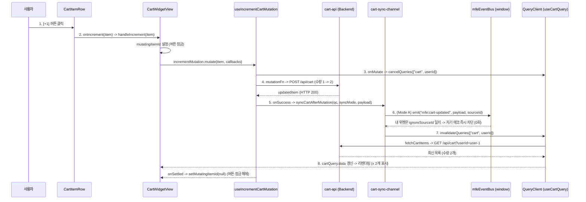

# Study 13. 장바구니 `[+1]` 클릭부터 화면 갱신까지 전체 실행 흐름과 초고속 응답 로딩 UX

> **문서 목적**: `apps/remote-cart`의 상태 동기화 코드를 파일 단위가 아니라 **사용자 관점(유저가 `[+1]` 버튼을 누르는 순간부터 화면 수량이 `1개 → 2개`로 바뀔 때까지)**의 시간 순서대로 함수·파라미터 단위로 추적하고, 실무에서 10~150ms 수준의 초고속 API 응답을 다룰 때 버튼 크기 출렁임과 `disabled` 커서 깜빡임을 방지하는 UX 표준 패턴을 정리한 학습 가이드입니다.
>
> **관련 문서**:
> - MFE `Mode A` 자기 에코 차단 및 `QueryClient` 동기화 채널 심화: [Study 12](./12-mfe-event-self-echo-and-queryclient-sync.md)
> - 비동기 요청 취소(`AbortController` · `AbortSignal`): [Study 08](./08-abort-signal-and-async-cancellation.md)
> - 풀스택 실전 이슈(응답 역전 · 중복 클릭 방지): [Study 05](./05-fullstack-service-real-world-issues.md)

---

## Part 1. 유저의 `[+1]` 클릭부터 화면 갱신까지 (8단계 완전 추적)

> **0단계 (클릭 전 사전 세팅)**  
> 화면이 처음 열렸을 때 [`CartWidget.tsx`](../../apps/remote-cart/src/exposed/CartWidget.tsx)가 `<QueryClientProvider>`로 캐시 창고(`activeQueryClient`)를 열어두고, [`CartWidgetView.tsx`](../../apps/remote-cart/src/features/cart/ui/CartWidgetView.tsx)가 ① `useCartQuery`로 장바구니 목록(수량 1개)을 불러와 화면에 표시하고, ② Mode A라면 `useCartSyncChannel`로 이벤트 수신 리스너를 열어둔 상태입니다.

### 전체 실행 플로우 다이어그램 (`Mode A` 기준)



---

### 단계별 함수 · 파라미터 상세 추적

#### 1단계: 유저가 `[+1]` 버튼 클릭
- **위치**: [`CartItemRow.tsx`](../../apps/remote-cart/src/features/cart/ui/CartItemRow.tsx)
- **실행 함수**: `onIncrement(item)`
- **전달 파라미터**:
  - `item`: 방금 클릭한 상품 1줄 객체 (`{ id: 1, productId: 1, productName: '기계식 무선 키보드 Pro', price: 129000, quantity: 1, ... }`)
- **동작**: 버튼 클릭을 감지해 부모 컴포넌트(`CartWidgetView`)가 넘겨준 `handleIncrement` 함수를 실행합니다.

#### 2단계: 버튼 잠금(중복 클릭 방지) + 뮤테이션 출발
- **위치**: [`CartWidgetView.tsx`](../../apps/remote-cart/src/features/cart/ui/CartWidgetView.tsx)
- **실행 함수**: `handleIncrement(item)` → `incrementMutation.mutate(item, { onError, onSettled })`
- **전달 파라미터**:
  - `item`: 1단계에서 받은 상품 객체
  - `onError(err)`: 요청 실패 시 인라인 에러 배너(`mutationErrorReport`)를 표시하는 콜백
  - `onSettled()`: 성공·실패 여부와 무관하게 작업이 끝나면 `setMutatingItemId(null)`로 버튼 잠금을 해제하는 콜백
- **동작**:
  1. `setMutationErrorReport(null)`로 이전 에러 배너를 지웁니다.
  2. `setMutatingItemId(item.id)`로 해당 상품 행의 `[+1]`/`[삭제]` 버튼을 로딩·비활성화 상태로 잠급니다.
  3. `incrementMutation.mutate(...)`를 호출해 실제 쓰기 작업을 TanStack Query에 위임합니다.

#### 3단계: 출발 직전, 옛날 조회 요청 취소 (`onMutate`)
- **위치**: [`use-cart-queries.ts`](../../apps/remote-cart/src/features/cart/model/use-cart-queries.ts) (`useIncrementCartMutation`)
- **실행 함수**: `activeQueryClient.cancelQueries({ queryKey })`
- **전달 파라미터**:
  - `queryKey`: `['cart', 'user-1']` (`buildCartUserQueryKey(validUserId)` 반환값)
- **동작**:  
  실제 `POST /api/cart` 요청이 출발하기 **직전에**, 이미 진행 중이던 구버전 `GET /api/cart` 요청이 있다면 `AbortSignal`로 즉시 취소합니다. 느리게 도착한 구버전 응답이 최신 수량을 덮어쓰는 응답 역전(Race Condition)을 차단합니다.

#### 4단계: 백엔드 서버에 수량 추가 요청 (`mutationFn`)
- **위치**: [`use-cart-queries.ts`](../../apps/remote-cart/src/features/cart/model/use-cart-queries.ts) → [`cart-api.ts`](../../apps/remote-cart/src/features/cart/api/cart-api.ts)
- **실행 함수**: `postIncrementCartItem(params)`
- **전달 파라미터**:
  - `userId`: `'user-1'` (장바구니 소유 사용자 ID)
  - `productId`: `1` (수량을 늘릴 상품 ID)
  - `quantity`: `1` (추가 수량)
  - `addedFromHost`: `'rspack'` | `'vite'` | `'standalone'` (요청 출처 호스트)
  - `apiBaseUrl`: `'http://localhost:4000/api'`
- **동작**: 백엔드에 `POST /api/cart`를 호출해 DB 수량을 `1 → 2`로 갱신하고, 응답 본문(`updatedItem`)을 Zod 스키마로 검증해 반환합니다.

#### 5단계: 서버 저장 성공 → 동기화 진입 (`onSuccess`)
- **위치**: [`use-cart-queries.ts`](../../apps/remote-cart/src/features/cart/model/use-cart-queries.ts) → [`cart-sync-channel.ts`](../../apps/remote-cart/src/features/cart/model/cart-sync-channel.ts)
- **실행 함수**: `syncCartAfterMutation(queryClient, syncMode, eventPayload)`
- **전달 파라미터**:
  1. `queryClient`: 현재 위젯의 캐시 창고 (`activeQueryClient`)
  2. `syncMode`: `'mode-a-event'` (Mode A) 또는 `'mode-b-query'` (Mode B)
  3. `eventPayload`: 타 앱에 전파할 변경 페이로드 (`{ action: 'add', userId: 'user-1', productId: 1, productName: '...', quantity: 1, sourceHost: 'rspack', timestamp: '...' }`)
- **동작**:
  - **Mode A일 때**: `getOrCreateChannel(queryClient)`로 내 창고 전용 `sourceId`(예: `'remote-cart:abc-123'`)를 조회해 `mfeEventBus.emit('mfe:cart-updated', eventPayload, { sourceId })`로 브라우저 전체에 방송합니다. (`try/catch`로 외부 리스너 오류가 로컬 갱신을 막지 않도록 격리)
  - **Mode B일 때**: 이벤트 방송을 건너뛰고 바로 7단계로 넘어갑니다.

#### 6단계: 브라우저 방송 전파 & 자기 에코 차단 *(Mode A 한정)*
- **위치**: [`event-bus.ts`](../../apps/remote-shared/src/features/utils/model/event-bus.ts)
- **실행 함수**: `mfeEventBus.emit(...)` → `window.dispatchEvent(...)` → 등록된 `listener(event)`
- **전달 파라미터**:
  - `event.detail`: `{ ...eventPayload, __mfeSourceId: 'remote-cart:abc-123' }`
- **동작**:
  1. **방금 클릭한 내 위젯 자신**: 구독 시 등록한 `{ ignoreSourceId: 'remote-cart:abc-123' }`와 `__mfeSourceId`가 일치하므로 **Zod 파싱 전 입구에서 즉시 `return`으로 차단**합니다. 덕분에 내 위젯은 `수신 이벤트 0회`를 유지하고 중복 `GET`을 방지합니다.
  2. **화면에 떠 있는 다른 독립 위젯 B (있다면)**: 위젯 B는 `ignoreSourceId`가 다르므로 통과하여 ① `receivedCountByUser`를 `+1` 증가시키고, ② `channel.listeners` 일괄 알림으로 `useSyncExternalStore` 배지를 `1회`로 갱신하며, ③ 위젯 B의 캐시도 `invalidateQueries`로 새로고침합니다.

#### 7단계: 내 위젯 캐시 무효화 → 최신 목록 재조회
- **위치**: [`cart-sync-channel.ts`](../../apps/remote-cart/src/features/cart/model/cart-sync-channel.ts) → [`use-cart-queries.ts`](../../apps/remote-cart/src/features/cart/model/use-cart-queries.ts) → [`cart-api.ts`](../../apps/remote-cart/src/features/cart/api/cart-api.ts)
- **실행 함수**: `queryClient.invalidateQueries({ queryKey })` → `fetchCartItems(params)`
- **전달 파라미터**:
  - `invalidateQueries`: `{ queryKey: ['cart', 'user-1'] }`
  - `fetchCartItems`: `{ userId: 'user-1', apiBaseUrl, simulateDelay, delayMs, signal }`
- **동작**:
  1. `['cart', 'user-1', ...]`로 시작하는 캐시를 상한 상태(`stale`)로 표시합니다.
  2. `useCartQuery`가 자동 반응해 `GET /api/cart?userId=user-1`을 호출하고, **수량 2개가 반영된 최신 목록**을 받아와 캐시에 저장합니다.

#### 8단계: 화면 리렌더링 & 버튼 잠금 해제
- **위치**: [`CartWidgetView.tsx`](../../apps/remote-cart/src/features/cart/ui/CartWidgetView.tsx) → [`CartItemRow.tsx`](../../apps/remote-cart/src/features/cart/ui/CartItemRow.tsx)
- **동작**:
  1. `cartQuery.data`가 새 배열로 바뀌며 `CartWidgetView`와 `CartItemRow`가 리렌더링되어 화면에 **`× 2개`**와 새 합계 금액이 표시됩니다.
  2. 2단계의 `onSettled`가 실행되어 `setMutatingItemId(null)`로 `[+1]` 버튼의 잠금이 풀리며 전체 사이클이 완료됩니다.

---

### 한눈에 보는 8줄 요약
1. `[+1]` 클릭 (`CartItemRow` → `onIncrement(item)`)
2. 버튼 잠금 + 뮤테이션 시작 (`handleIncrement` → `incrementMutation.mutate`)
3. 옛날 GET 요청 취소 (`onMutate` → `cancelQueries(['cart', 'user-1'])`)
4. DB에 수량 +1 저장 (`mutationFn` → `POST /api/cart`)
5. 저장 성공 후 동기화 진입 (`onSuccess` → `syncCartAfterMutation`)
6. *(Mode A)* `sourceId` 첨부 방송 (`mfeEventBus.emit`) → 내 자신은 `ignoreSourceId`로 차단, 타 위젯만 수신
7. 내 캐시 무효화 & 최신 목록 재조회 (`invalidateQueries(['cart', 'user-1'])` → `GET /api/cart`)
8. 새 수량(`2개`) 화면 표시 + 버튼 잠금 해제 (`onSettled`)

---

## Part 2. 초고속 API 응답 시 버튼 로딩 · `disabled` UX 실무 패턴

### 1. 현재 구현에서 깜빡임·크기 출렁임이 발생하는 원인

로컬 개발 서버나 초고속 API 환경(응답 시간 `10~50ms`)에서는 아래 두 가지가 겹치면서 부자연스러운 UX가 체감될 수 있습니다.

1. **로딩 중 버튼 텍스트 치환으로 인한 가로 폭 출렁임 (Layout Jitter)**  
   - [`CartSummaryCard.tsx`](../../apps/remote-cart/src/features/cart/ui/CartSummaryCard.tsx)의 `{isClearing ? '비우는 중...' : '장바구니 비우기'}`처럼 텍스트 자체를 바꾸면, 0.03초 동안 버튼 가로 폭이 줄었다가 원래대로 돌아오는 흔들림이 발생합니다.
2. **`isLoading` 즉시 `disabled` 적용으로 인한 커서·투명도 깜빡임**  
   - [`Button.tsx`](../../apps/remote-shared/src/features/ui/components/Button.tsx)에서 `isLoading`이 `true`가 되는 0ms 시점에 곧바로 `disabled={true}`가 적용되면, 초고속 응답에서도 버튼이 찰나에 흐려지고 금지 커서(`cursor: not-allowed`, 🚫)가 번쩍입니다.

---

### 2. 실무 표준 UX 해법 5가지

| # | 실무 기법 | 핵심 원리 | 해결되는 문제 |
| :-: | :--- | :--- | :--- |
| **1** | **기능 잠금(0ms) vs 시각 로딩 지연(150~300ms) 분리** | 연타 차단 로직은 클릭 즉시(0ms) 작동시키되, 스피너·흐려짐은 `200ms` 이상 걸릴 때만 표시 | 초고속 응답(10~150ms) 시 화면 깜빡임 0회 (*Nielsen 0.1초 법칙*) |
| **2** | **Zero Layout Shift 버튼 (텍스트 폭 보존)** | 로딩 중 글씨를 바꾸지 않고 원래 텍스트를 `visibility: hidden`으로 숨긴 채 중앙에 스피너만 겹침 | 버튼 가로·세로 크기 출렁임(Layout Jitter) 완전 제거 |
| **3** | **로딩 중 커서 분리 (`aria-busy` vs `disabled`)** | 로딩 중에는 `cursor: progress` 또는 `default` 유지, 권한·조건 미충족 비활성화에만 `not-allowed` 사용 | 클릭 직후 마우스 아래 🚫 커서 번쩍임 거부감 제거 |
| **4** | **최소 표시 시간 (`minDuration`, `spin-delay`)** | 지연 후 스피너가 일단 표시되었다면 최소 `300~400ms`는 유지한 뒤 해제 | 200ms에 겨우 떴다가 210ms에 꺼지는 10ms 번쩍임 방지 |
| **5** | **낙관적 업데이트 (Optimistic UI)** | 장바구니 `[+1]`·좋아요 같은 고빈도 액션은 클릭 즉시 화면 숫자를 먼저 올리고, 실패 시에만 롤백 | 버튼 잠금·대기 없는 즉각적인 반응성 제공 |

---

### 3. 실무 구현 레퍼런스 (응답 시간 감지 3가지 + 크기 고정 CSS)

#### 방법 A. 전용 초경량 라이브러리 — `spin-delay` (실무 가장 보편적)
응답 시간을 미리 예측하는 것이 아니라, 내부 상태 머신(`IDLE → DELAY → DISPLAY → EXPIRE`)과 `setTimeout`으로 **지연 표시 + 최소 유지 시간**을 1줄로 처리합니다.

```tsx
import { useSpinDelay } from 'spin-delay';

// 기능적 연타 차단은 isMutating(0ms)으로 즉시 처리하고,
// 시각적 스피너는 showSpinner(200ms 지연 + 최소 300ms 유지)로 분리합니다.
const showSpinner = useSpinDelay(isMutating, {
  delay: 200,
  minDuration: 300,
});
```

#### 방법 B. 라이브러리 없이 직접 작성하는 15줄 커스텀 훅 (`useDelayedLoading`)
최소 유지 시간(`minDuration`) 없이 **지연 표시**만 필요할 때 사용하는 표준 패턴입니다.

```ts
import { useEffect, useState } from 'react';

export function useDelayedLoading(isLoading: boolean, delayMs = 200): boolean {
  const [showLoading, setShowLoading] = useState(false);

  useEffect(() => {
    // 200ms 전에 응답이 완료되면 cleanup에서 clearTimeout이 실행되어 끝까지 false 유지
    if (!isLoading) {
      setShowLoading(false);
      return;
    }

    const timerId = setTimeout(() => {
      setShowLoading(true);
    }, delayMs);

    return () => clearTimeout(timerId);
  }, [isLoading, delayMs]);

  return showLoading;
}
```

#### 방법 C. Zero Layout Shift 버튼 + CSS `transition-delay` 패턴
원래 텍스트와 스피너를 CSS Grid의 같은 셀(`grid-area: 1 / 1`)에 겹쳐 두면 버튼 크기가 1px도 변하지 않습니다.

```css
.btn-content-grid {
  display: inline-grid;
  place-items: center;
}

.btn-content-grid > * {
  grid-area: 1 / 1;
}

/* 로딩 중에도 원래 텍스트가 자리를 차지하도록 visibility만 숨김 (폭 100% 고정) */
.btn-label[data-loading="true"] {
  visibility: hidden;
}

/* JS 타이머 없이 CSS만으로 200ms 미만 초고속 응답의 스피너 번쩍임을 숨기는 트릭 */
.btn-spinner {
  opacity: 0;
  transition: opacity 150ms ease 200ms;
}

.btn-spinner[data-loading="true"] {
  opacity: 1;
}

/* 로딩 중에는 금지(not-allowed) 커서 대신 진행(progress) 또는 기본 커서 유지 */
.mfe-ui-button[aria-busy="true"] {
  cursor: progress;
}
```
