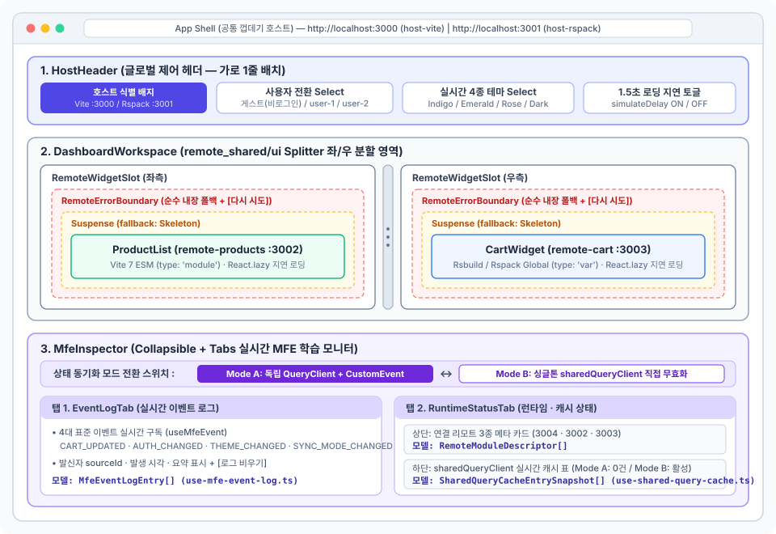
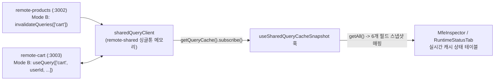

# 🏛️ Study 14. MFE 공통 껍데기 호스트(App Shell) · 장애 격리 · `MfeInspector` 아키텍처 가이드

> **문서 목적**: `apps/host-vite` (`Port 3000`, Vite 7)와 `apps/host-rspack` (`Port 3001`, Rsbuild/Rspack) 두 호스트 앱이 **번들러와 포트만 다를 뿐 100% 공통으로 구현하는 App Shell 아키텍처**의 설계 기준 문서입니다. 화면 영역 구조, 5대 내부 데이터 모델(`SharedQueryCacheEntrySnapshot`, `RemoteModuleDescriptor` 등)의 존재 이유와 데이터 흐름, `RemoteErrorBoundary` 비의존 격리 원칙, 그리고 `Vite` vs `Rspack` 이종 리모트 소비 설정 차이를 정리합니다.
>
> **관련 문서**:
> - MFE 핵심 개념 및 6대 실습 프로세스: [Study 01](./01-mfe-concepts-and-guide.md)
> - MFE 14대 실전 고유 이슈(장애 격리 · `sourceId` · `@mf-types`): [Study 04](./04-mfe-real-world-pitfalls-and-solutions.md)
> - `Mode A` 자기 에코 차단 및 `QueryClient` 동기화: [Study 12](./12-mfe-event-self-echo-and-queryclient-sync.md)
> - Phase 1 서비스 간 공통 연동 계약 정본(SSOT): [01-plan-and-design.md](../features/20261027-phase1-service-contracts/01-plan-and-design.md)

---

## § 1. 공통 껍데기 호스트(App Shell)의 역할 경계

마이크로 프론트엔드에서 호스트는 거대한 모놀리식 앱이 아니라 **비즈니스 도메인 로직을 직접 소유하지 않는 얇은 껍데기(Thin Shell)**여야 합니다.

| 구분 | 호스트가 소유하는 책임 (O) | 호스트가 소유하지 않는 책임 (X) |
| :--- | :--- | :--- |
| **도메인 데이터** | 글로벌 인증 사용자(`GET /api/users`, `POST /api/auth/login`) 및 세션 전파 | 상품 목록 필터링·장바구니 수량/삭제 비즈니스 로직 (`remote-products`, `remote-cart` 소유) |
| **UI · 레이아웃** | 상단 글로벌 헤더, 리모트 배치 틀(`Splitter`), `MfeInspector` 모니터 | `@ark-ui/react` · `clsx` 직접 설치 (`remote_shared/ui` 단일 창구 소비) |
| **안정성 · 관측** | 리모트별 `RemoteErrorBoundary` + `Suspense` 격리, 실시간 이벤트·캐시 관측 | 리모트 내부의 개별 에러 배너·쿼리 구현 세부사항 |

---

## § 2. 두 호스트 공통 화면 아키텍처 (화면 계층 구조 및 영역 책임)

`host-vite(3000)`와 `host-rspack(3001)`은 모두 아래 **3단 화면 구조**를 동일하게 제공합니다.

| 화면 단 | 영역 / 배치 | 담당 컴포넌트 | 주요 UI 요소 및 동작 |
| :---: | :--- | :--- | :--- |
| **1단 (상단)** | **글로벌 제어 헤더** *(가로 1줄 배치)* | `HostHeader.tsx` | - 호스트 식별 배지 (`Vite Host :3000` / `Rspack Host :3001`) - 사용자 로그인/전환 `Select` (`게스트(비로그인)` · `홍길동(user-1)` · `이순신(user-2)`, `POST /api/auth/login`) - 실시간 4종 테마 `Select` (`Indigo` · `Emerald` · `Rose` · `Dark`, `useTheme`) - `1.5초 로딩 지연` 토글 버튼 (`simulateDelay ON/OFF`) |
| **2단 (중앙)** | **좌측 슬롯** (`Splitter` 좌측) | `DashboardWorkspace.tsx` `RemoteWidgetSlot.tsx` `RemoteErrorBoundary.tsx` | - `<RemoteErrorBoundary>` (순수 내장 폴백 + `[다시 시도]` 리마운트) - `<Suspense fallback={<Skeleton />}>` - `remote_products/ProductList` (`Port 3002`, `React.lazy` 지연 로딩) |
| **2단 (중앙)** | **우측 슬롯** (`Splitter` 우측) | `DashboardWorkspace.tsx` `RemoteWidgetSlot.tsx` `RemoteErrorBoundary.tsx` | - `<RemoteErrorBoundary>` (순수 내장 폴백 + `[다시 시도]` 리마운트) - `<Suspense fallback={<Skeleton />}>` - `remote_cart/CartWidget` (`Port 3003`, `React.lazy` 지연 로딩) |
| **3단 (하단)** | **실시간 학습 모니터 상단** *(접이식 `Collapsible`)* | `MfeInspector.tsx` | - 상태 동기화 모드 전환 스위치 (`Mode A: CustomEvent` ↔ `Mode B: sharedQueryClient`) - 전환 시 `mfe:sync-mode-changed` 이벤트 발행 및 두 리모트 `syncMode` Props 갱신 |
| **3단 (하단)** | **모니터 탭 1** (`Tabs`) | `EventLogTab.tsx` | - 표준 4대 이벤트(`CART_UPDATED`, `AUTH_CHANGED`, `THEME_CHANGED`, `SYNC_MODE_CHANGED`) 실시간 스트림 로그 (`sourceId`, 발생 시각, 요약) 및 `[로그 비우기]` |
| **3단 (하단)** | **모니터 탭 2** (`Tabs`) | `RuntimeStatusTab.tsx` | - **상단**: 연결된 3대 리모트(`3004`, `3002`, `3003`) 메타 카드 (`RemoteModuleDescriptor[]`) - **하단**: `sharedQueryClient` 실시간 캐시 테이블 (`SharedQueryCacheEntrySnapshot[]`, `Mode A` 빈 캐시 vs `Mode B` 공용 캐시 비교) |

---

## § 3. 호스트 공통 5대 데이터 모델과 사용처·데이터 흐름 매핑

호스트 앱 내부 상태와 `MfeInspector` 관측 UI를 일관된 타입으로 다루기 위해 아래 **5개 내부 인터페이스**를 정의합니다.

| 인터페이스명 | 생성·관리 위치 (Producer) | 소비·렌더링 위치 (Consumer) | 왜 필요한가? (역할) |
| :--- | :--- | :--- | :--- |
| **`HostStoredAuthSession`** | `auth-api.ts` + `use-host-auth.ts` (`createScopedStorage`) | `HostHeader`, `DashboardWorkspace` (`userId` Props) | 로그인한 사용자 정보·토큰을 호스트 네임스페이스 `localStorage`에 안전하게 영속화하고 새로고침 시 `Zod` 검증 후 복원 |
| **`HostPreferences`** | `host-preferences.ts` (`createScopedStorage`) | `App`, `HostHeader`, `MfeInspector` | 사용자가 선택한 `syncMode`와 `simulateDelay` 학습 설정을 새로고침 후에도 유지 |
| **`MfeEventLogEntry`** | `use-mfe-event-log.ts` (`useMfeEvent` 4대 구독) | `MfeInspector` → **`EventLogTab`** | `mfeEventBus`에 흐르는 4대 이벤트와 `meta.sourceId` 발신 출처를 최신순 로그 목록으로 렌더링 |
| **`RemoteModuleDescriptor`** | `host-remotes.ts` (또는 상수 메타 배열) | `MfeInspector` → **`RuntimeStatusTab` 상단** | 현재 호스트가 소비 중인 3대 리모트(`3004`, `3002`, `3003`)의 포트·번들러(`Vite ESM` vs `Rspack Global`)·매니페스트 URL을 카드로 반복 렌더링 |
| **`SharedQueryCacheEntrySnapshot`** | `use-shared-query-cache.ts` (`sharedQueryClient.getQueryCache()`) | `MfeInspector` → **`RuntimeStatusTab` 하단** | `Mode A`(공용 캐시 비어 있음)와 `Mode B`(공용 `sharedQueryClient` 캐시 실시간 갱신)의 메모리 차이를 눈으로 비교 관찰 |

### § 3.1 `SharedQueryCacheEntrySnapshot` 상세 원리 (`QueryCache` 공식 API 활용)

- **왜 별도 스냅샷 객체로 추출하는가?**
  - `sharedQueryClient`는 `remote-shared`가 `new QueryClient(...)`로 생성해 노출한 표준 `@tanstack/react-query` v5 인스턴스입니다.
  - `TanStack Query`는 내부 캐시를 관찰할 수 있는 공식 API 3종을 기본 제공합니다.
    1. `sharedQueryClient.getQueryCache()`: 내부 `QueryCache` 저장소 반환
    2. `queryCache.subscribe(listener)`: 캐시에 쿼리 추가·삭제·무효화(`invalidateQueries`)·상태 변경이 생길 때마다 알림 발행 (해제 함수 반환)
    3. `queryCache.getAll()`: 현재 캐시에 저장된 모든 `Query` 인스턴스 배열 반환
  - 원본 `Query` 인스턴스는 내부 메서드가 붙어 있고 상태 객체가 직접 변이(mutate)되므로 React 컴포넌트에 그대로 넘기면 변경 감지가 깨지거나 불필요한 결합이 생깁니다.
  - 따라서 `use-shared-query-cache.ts` 훅이 `queryCache.subscribe` 콜백 안에서 화면 표시에 필요한 **6개 읽기 전용 필드(`queryKeyLabel`, `status`, `fetchStatus`, `observerCount`, `dataUpdatedAt`, `isInvalidated`)만 순수 평문 객체 배열로 스냅샷 복사**해 `RuntimeStatusTab`에 전달합니다.

- **학습 관찰 포인트 (`Mode A` vs `Mode B`)**:
  - **`Mode A ('mode-a-event')`**: `remote-products`와 `remote-cart`가 각자 독립 `localQueryClient`를 사용하므로 `RuntimeStatusTab`의 `sharedQueryClient` 테이블은 **비어 있음(`0건`)**을 유지하고, 대신 `EventLogTab`에 `mfe:cart-updated`가 기록됩니다.
  - **`Mode B ('mode-b-query')`**: `EventLogTab`에는 `mfe:cart-updated`가 찍히지 않고, 대신 `RuntimeStatusTab`의 `sharedQueryClient` 테이블에 `["cart","user-1",...]` 항목이 **`observerCount: 1` · `fetchStatus: fetching → idle` · `status: success`**로 실시간 전환되는 모습을 직접 확인할 수 있습니다.

### § 3.2 `RemoteModuleDescriptor` 상세 원리 (이종 번들러 토폴로지 가시화)

- [Study 01 § 4 프로세스 ①~②](./01-mfe-concepts-and-guide.md)의 핵심 학습 목표는 **"사용자가 보고 있는 한 화면이 실제로 어떤 포트·어떤 번들러의 원격 모듈들로 조립되어 있는지"**를 투명하게 이해하는 것입니다.
- `RemoteModuleDescriptor[]`는 호스트가 소비하는 3대 원격 앱(`remote_shared:3004`, `remote_products:3002`, `remote_cart:3003`)의 **이름, 한글 라벨, 포트, 번들러 포맷(`Vite 7 ESM` vs `Rsbuild/Rspack Global`), 매니페스트 URL, 소비 경로**를 구조화하여 `RuntimeStatusTab` 상단 카드 목록으로 일관되게 렌더링합니다.

---

## § 4. 리모트 장애 격리(`RemoteErrorBoundary` + `Suspense`)와 2단 진입점 원칙

### § 4.1 왜 도메인 리모트(`ProductList`, `CartWidget`)는 `main.ts`에서 프리로드하면 안 되는가?

- `remote_shared/{utils,theme,ui}`는 호스트 껍데기 자체(헤더, 레이아웃, 테마)를 그리는 기반 모듈이므로 `main.ts`에서 `Promise.all`로 선행 프리로드한 뒤 `bootstrap.tsx`를 실행합니다. *(만약 `remote_shared:3004` 자체마저 다운된 극단 상황이라면, `main.ts` 안에 DOM·스타일을 직접 적지 않고 `.catch()`에서 `bootstrap-fallback.ts` + `bootstrap-fallback.css`를 지연 로드해 `index.html`의 `<template>` 마크업을 복제하고 `textContent`로 안전하게 렌더링해 백지 화면을 방지합니다.)*
- 반면 **`remote_products/ProductList`와 `remote_cart/CartWidget`은 절대 `main.ts`에서 선행 로드하지 않습니다.**
  - 만약 `main.ts`에 도메인 리모트를 넣으면 장바구니 서버(`3003`)가 꺼졌을 때 `Promise.all` 전체가 실패하여 **호스트와 상품 목록까지 통째로 먹통이 되어 장애 격리 원칙이 무너집니다.**
  - 따라서 도메인 리모트는 반드시 컴포넌트 레벨에서 `React.lazy(() => import('remote_cart/CartWidget'))`로 지연 로딩하고, 각각의 `<RemoteWidgetSlot>`(`<RemoteErrorBoundary>` + `<Suspense fallback={<Skeleton />}>`) 안에 독립 배치합니다.

### § 4.2 왜 `RemoteErrorBoundary`는 `remote_shared/ui`에 의존하면 안 되는가?

- [Study 02 § 4](./02-polyrepo-and-architecture-decisions.md)와 [Study 04 #14](./04-mfe-real-world-pitfalls-and-solutions.md)의 핵심 원칙입니다.
- `RemoteErrorBoundary`의 폴백 UI마저 `remote_shared/ui`의 `<Button>`이나 `clsx`에 의존하면, 공통 UI 장애나 원격 청크 오류 상황에서 **에러 화면 자체를 그리다 2차 크래시**가 발생할 수 있습니다.
- 따라서 `RemoteErrorBoundary.tsx`는 **`react-error-boundary` 기반 함수형 래퍼(`fallbackRender`, `onError`, `onReset`)와 CSS Modules(`RemoteErrorBoundary.module.css`, 시맨틱 CSS 변수 + 안전한 기본 폴백값)**만으로 구현하며, `[다시 시도]` 버튼 클릭 시 `resetErrorBoundary()`로 에러 상태를 초기화하고 `onReset` → `onRetry`로 슬롯의 리마운트 키(`retryKey + 1`)를 증가시켜 전체 새로고침 없이 해당 리모트만 재연결합니다.

---

## § 5. `Vite` 호스트(`3000`) vs `Rspack` 호스트(`3001`) 번들러별 설정 비교

두 호스트는 위 `§ 1 ~ § 4`의 화면·상태·모니터 아키텍처를 동일하게 공유하며, 오직 **번들러 설정 파일과 호스트 식별 값(`hostType`, `port`, `sourceId` prefix, `storage` scope)**만 다릅니다.

| 비교 항목 | `apps/host-vite` (`Port 3000`) | `apps/host-rspack` (`Port 3001`) |
| :--- | :--- | :--- |
| **번들러 & MF 플러그인** | `Vite 7` + `@module-federation/vite` | `Rsbuild (Rspack 1.7)` + `@module-federation/rsbuild-plugin` |
| **호스트 식별자** | `hostType: 'vite'`, `scopeId: 'host-vite'`, `sourceId` prefix: `'host-vite'` | `hostType: 'rspack'`, `scopeId: 'host-rspack'`, `sourceId` prefix: `'host-rspack'` |
| **`remote_shared (3004, Vite ESM)` 소비** | `type: 'module'`, `entry: 'http://localhost:3004/mf-manifest.json'` | `'remote_shared@http://localhost:3004/mf-manifest.json'` |
| **`remote_products (3002, Vite ESM)` 소비** | `type: 'module'`, `entry: 'http://localhost:3002/mf-manifest.json'` | `'remote_products@http://localhost:3002/mf-manifest.json'` |
| **`remote_cart (3003, Rspack Global)` 소비** | **`type: 'var'`** 명시 (`mf-manifest.json`의 `remoteEntry.type: 'global'` 대응 — `module`로 두거나 생략 시 경고/로딩 실패) | `'remote_cart@http://localhost:3003/mf-manifest.json'` (동종 Rspack 소비) |
| **`shared` 싱글톤 6종 통일** | `react`, `react/jsx-runtime`, `react/jsx-dev-runtime`, `react-dom`, `react-dom/client`, `@tanstack/react-query` | 동일 6종 `singleton: true` 통일 |
| **파일 워처 / 타입 힌트 방어** | `dev.disableDynamicRemoteTypeHints: true`, `dts.consumeTypes` | `dev.disableDynamicRemoteTypeHints: true`, `watchOptions.ignored`에 `@mf-types`·`.mf` 제외 |
